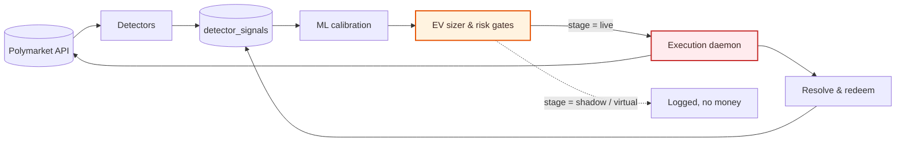

# OraclePoly

A trading bot for [Polymarket](https://polymarket.com) prediction markets: detectors look for a gap between price and probability, ML calibration turns a detector's raw confidence into an honest probability, a risk engine sizes the bet, and an execution daemon places the order in the CLOB. From signal to fill, no human in the loop.


> [!WARNING]
> **This is research code, not a financial product.** The bot places real orders with real money.
>
> There is no guarantee of profitability. Most detectors in this repository have negative or unproven edge, and some backtests didn't hold up in production — that's documented in `docs/backtests/`, not hidden. Automated trading on prediction markets is restricted or banned in a number of jurisdictions; checking that is on you. The code is provided "as is", with no warranty (see [LICENSE](LICENSE)).

## How it works



Data comes from the Gamma API, the CLOB, and a WebSocket stream. About twenty detectors each hunt a different inefficiency — whale copy-trading, calendar spreads, event-driven drift, divergence from Kalshi — and write a signal to `detector_signals`. Beta calibrators and LightGBM turn a detector's raw confidence into a probability you can trust; an EV sizer computes the Kelly stake, and risk gates cut anything that fails exposure, drawdown, or price-staleness checks. Orders go to the CLOB as maker or taker, winning positions get redeemed, and the outcome flows back into the database to train the calibrators.

The core idea: **a detector doesn't get access to money until it earns it.** Every detector goes through four stages, and promotion between them is always manual:

| Stage | What happens | Money |
|---|---|---|
| **Backtest** | hypothesis checked against historical data | $0 |
| **Shadow** | detector emits signals on live data, outcome awaits resolution | $0 |
| **Virtual** | signals run through the full pipeline and get "placed" virtually | $0 |
| **Live** | real orders on the CLOB | real |

The stage lives in `detector_state.stage` and gates access to money independently of whether signal emission is running. Details and promotion criteria — [docs/detector_lifecycle.md](docs/detector_lifecycle.md).

## Quick start

```bash
git clone git@github.com:<your-user>/oraclepoly.git && cd oraclepoly
cp .env.example .env          # fill in DATABASE_URL, REDIS_URL, OPENAI_API_KEY, TELEGRAM_BOT_TOKEN
docker compose up -d --build
```

Backend comes up at `http://localhost:8001/docs` (Swagger), frontend at `http://localhost:5173`.

`EXECUTION_ENABLED=false` in `.env` by default: without it the bot computes and writes to the database but doesn't send orders. Don't flip this until you've run your detectors through shadow and virtual.

<details>
<summary>Running without Docker</summary>

```bash
python3 -m venv .venv && source .venv/bin/activate
pip install -r requirements.txt
docker compose up -d postgres redis     # still need the database and queue
./start.sh                              # backend :8001 + worker + frontend :5173
```

</details>

## Verification

```bash
pytest tests/ -v --tb=short
ruff check app/ && cd client && npm run lint
```

## Structure

```
app/
  detectors/    # detectors, one file per hypothesis
  calibration/  # L1 Beta calibrators, EV sizer, Kelly
  backtest/     # paired tick replay, Wilson CI
  jobs/         # 89 cron jobs: scans, execution, redeem, calibrator fitting
  api/          # FastAPI endpoints
  core/         # config, scoring, auth, cache
  services/     # DB, Polymarket CLOB, WebSocket, Telegram
client/src/     # React 19 + Vite + Tailwind 4 — admin panel by stage
migrations/     # SQL, timestamp-prefixed, state-tracked
docs/           # architecture, deployment, runbooks, backtest reports
```

## Stack

Python 3.11 · FastAPI · PostgreSQL 16 (asyncpg) · Redis · LightGBM · React 19 · Vite · Tailwind 4 · Docker

## Documentation

- [Environment setup](docs/SETUP.md) · [Deployment](docs/DEPLOYMENT.md) · [Security](docs/SECURITY.md)
- [Detector Lifecycle](docs/detector_lifecycle.md) — source of truth for stages
- [Architecture](docs/architecture/) · [Backup & restore](docs/runbooks/backup_restore.md)
- [Backtest reports](docs/backtests/) — including the ones where the hypothesis didn't hold up
- [How to contribute](CONTRIBUTING.md)

## The honest bottom line

This didn't turn into money — saying that plainly instead of hiding behind "research code" in the header above.

Out of ~20 detectors, exactly one made it to `live`: D3 (cross-market arbitrage). It called direction correctly (Wilson lower bound 61.9% on real trades — not backtest, live fills), but execution economics ate the edge: thin order books, slippage, adverse selection on marketable orders. By the last measurement in this repo (`docs/knowledge/prediction_markets.md`), net was negative across 34 live trades; fixes to double-counted slippage and FOK-order logic shipped after that measurement and were never re-measured, so this isn't a final verdict on the detector — it's a snapshot of the problem that turned out to be central to the whole project: calling direction right was the easy half. Not giving it back on execution was the hard one. The rest of the detectors either failed backtest or sat in shadow/virtual with unproven edge — that's not neglect, that's an honest hypothesis test.

The second systemic failure was the gap between backtest and production. Several detectors that looked profitable on historical data showed negative net ROI in prod: fixed fees and real slippage in the backtest weren't modeled the way they actually behave on a live book. The lesson was worth more than the code — validation methodology mattered more than the number of detectors.

**What I'd do differently starting over:**

- **Fewer hypotheses, deeper validation.** Twenty detectors with weak edge is worse than three with strong edge. Most of the time went into the pipeline (detector → shadow → virtual → live) rather than into pushing even one strong edge to completion.
- **Execution is the strategy, not a detail.** D3 showed that calling direction right is half the job. The other half is not giving it back to slippage. Maker orders instead of taker, a depth gate before entry, simply not trading thin books at all — this should have been designed in from day one, not bolted on after the economics turned negative.
- **Honest validation, earlier.** `docs/backtests/` paired with production results for the same detector is the minimum bar a promotion to live should require. Here it showed up after a few painful cases, not from day one.
- **Cross-platform arbitrage (Kalshi) was never explored.** The infrastructure is partially there (`app/matchers/kalshi_polymarket_matcher.py`, `app/jobs/kalshi_*`), but API access never came through — a structural inefficiency between venues that nobody got to test in practice.

If you want to take this further, this is where the value is — not in predicting outcomes: execution (maker-first, depth-aware sizing), cross-platform arbitrage, and an honest backtest methodology with real execution-cost modeling. Signal detection is already oversupplied here; the last mile to actual money is what's unfinished.

## What isn't here

Internal material didn't make it into the public version: the `research/` directory (deep-research writeups behind each hypothesis), `docs/superpowers/` (internal plans and design specs), production runbooks with infra details. Code comments and migration headers sometimes still reference these files — the references were left as a trace of where a decision came from; the files themselves aren't in this repository.

Commit history was started fresh at publication: the private repository carried production details that were simpler not to carry over than to scrub from 2,700 commits.

## License

MIT — see [LICENSE](LICENSE).
