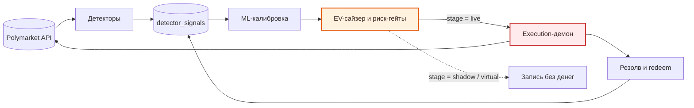

# OraclePoly

Торговый бот для prediction markets [Polymarket](https://polymarket.com): детекторы ищут расхождение цены и вероятности, ML-калибровка переводит уверенность детектора в честную вероятность, риск-движок считает размер ставки, execution-демон размещает ордер в CLOB. От сигнала до заполнения — без участия человека.


> [!WARNING]
> **Это исследовательский код, а не финансовый продукт.** Бот размещает реальные ордера на реальные деньги.
>
> Никаких гарантий прибыльности нет. У большинства детекторов в этом репозитории отрицательный или недоказанный edge, а часть бэктестов не воспроизвелась в проде — это задокументировано в `docs/backtests/`, а не спрятано. Автоматическая торговля на prediction markets ограничена или запрещена в ряде юрисдикций; проверять это — ваша задача. Код распространяется «как есть», без гарантий (см. [LICENSE](LICENSE)).

## Как это работает



Данные приходят из Gamma API, CLOB и WebSocket-стрима. Около двадцати детекторов ищут каждый свою неэффективность — копирование китов, календарные спреды, событийный дрейф, расхождение с Kalshi — и пишут сигнал в `detector_signals`. Beta-калибраторы и LightGBM переводят сырую уверенность детектора в вероятность, которой можно верить; EV-сайзер считает ставку по Келли, риск-гейты режут всё, что не проходит по exposure, просадке и свежести цены. Ордера уходят в CLOB как maker или taker, выигранные позиции редимятся, исход возвращается в базу и обучает калибраторы.

Ключевая идея — **детектор не получает доступ к деньгам, пока не заслужит**. Каждый проходит четыре стадии, и переход между ними всегда ручной:

| Стадия | Что происходит | Деньги |
|---|---|---|
| **Backtest** | гипотеза проверяется на исторических данных | $0 |
| **Shadow** | детектор эмитит сигналы на живых данных, исход ждёт резолва | $0 |
| **Virtual** | сигналы проходят весь пайплайн и «размещаются» виртуально | $0 |
| **Live** | реальные ордера в CLOB | реальные |

Стадия хранится в `detector_state.stage` и гасит доступ к деньгам независимо от того, работает ли эмиссия сигналов. Подробности и критерии промоута — [docs/detector_lifecycle.md](docs/detector_lifecycle.md).

## Быстрый старт

```bash
git clone git@github.com:<your-user>/oraclepoly.git && cd oraclepoly
cp .env.example .env          # заполнить DATABASE_URL, REDIS_URL, OPENAI_API_KEY, TELEGRAM_BOT_TOKEN
docker compose up -d --build
```

Backend поднимется на `http://localhost:8001/docs` (Swagger), фронтенд — на `http://localhost:5173`.

`EXECUTION_ENABLED=false` в `.env` по умолчанию: без него бот считает и пишет в базу, но не отправляет ордера. Не меняйте это значение, пока не прогнали свои детекторы через shadow и virtual.

<details>
<summary>Запуск без Docker</summary>

```bash
python3 -m venv .venv && source .venv/bin/activate
pip install -r requirements.txt
docker compose up -d postgres redis     # база и очередь всё же нужны
./start.sh                              # backend :8001 + worker + frontend :5173
```

</details>

## Проверка

```bash
pytest tests/ -v --tb=short
ruff check app/ && cd client && npm run lint
```

## Структура

```
app/
  detectors/    # детекторы, по файлу на гипотезу
  calibration/  # Beta-калибраторы L1, EV-сайзер, Kelly
  backtest/     # paired tick replay, Wilson CI
  jobs/         # 89 cron-задач: сканы, execution, redeem, fit калибраторов
  api/          # FastAPI endpoints
  core/         # config, scoring, auth, cache
  services/     # БД, Polymarket CLOB, WebSocket, Telegram
client/src/     # React 19 + Vite + Tailwind 4 — админ-панель по стадиям
migrations/     # SQL, timestamp-prefix, state-tracked
docs/           # архитектура, деплой, runbooks, отчёты бэктестов
```

## Стек

Python 3.11 · FastAPI · PostgreSQL 16 (asyncpg) · Redis · LightGBM · React 19 · Vite · Tailwind 4 · Docker

## Документация

- [Настройка окружения](docs/SETUP.md) · [Деплой](docs/DEPLOYMENT.md) · [Безопасность](docs/SECURITY.md)
- [Detector Lifecycle](docs/detector_lifecycle.md) — источник правды по стадиям
- [Архитектура](docs/architecture/) · [Backup & restore](docs/runbooks/backup_restore.md)
- [Отчёты бэктестов](docs/backtests/) — включая те, где гипотеза не подтвердилась
- [Как контрибьютить](CONTRIBUTING.md)

## Честный итог

В деньги это не превратилось — говорю прямо, а не прячу за «исследовательский код» в шапке.

Из ~20 детекторов до `live` дошёл фактически один — D3 (арбитраж связанных рынков). Направление он угадывал правильно (Wilson lower bound 61.9% на реальных сделках — не бэктест, живые исполнения), но экономика исполнения съедала edge: тонкий стакан, slippage, adverse selection на маркет-ордерах. По последнему замеру в репозитории (`docs/knowledge/prediction_markets.md`) — net отрицательный на 34 live-сделках; правки slippage-двойного-счёта и FOK-логики после этого деплоились, но эффект не переизмерялся заново, так что это не финальный приговор детектору — это фотография проблемы, которая была центральной весь проект: угадать направление оказалось проще, чем не отдать угаданное на исполнении. Остальные детекторы либо не прошли backtest, либо застряли в shadow/virtual с недоказанным edge — это не забытые черновики, это честный результат проверки гипотезы.

Второй системный провал — разрыв между бэктестом и продом. Несколько детекторов, которые в backtest выглядели прибыльными, в проде показывали отрицательный net ROI: фиксированная комиссия и реальный slippage в бэктесте считались не так, как они работают на живом стакане. Урок дороже кода — методология валидации значила больше, чем количество детекторов.

**Что бы я поменял, если начинать заново:**

- **Меньше гипотез, глубже проверка.** Двадцать детекторов на слабом edge — хуже, чем три на сильном. Большая часть времени ушла на конвейер (detector → shadow → virtual → live), а не на то, чтобы довести до ума хотя бы один сильный edge.
- **Исполнение — это и есть стратегия, не деталь.** D3 показал: правильно угадать направление — половина дела. Вторая половина — не отдать угаданное на слиппедже. Maker-ордера вместо taker, depth-гейт перед входом, вообще не заходить в тонкие стаканы — это должно было быть спроектировано с нуля, а не прикручено после того, как экономика показала минус.
- **Честная валидация раньше.** `docs/backtests/` вместе с прод-результатами по одному и тому же детектору — минимальный набор, без которого промоут в live не должен случаться. Здесь это появилось после нескольких болезненных случаев, а не с первого дня.
- **Кросс-платформенный арбитраж (Kalshi) не исследован.** Инфраструктура частично готова (`app/matchers/kalshi_polymarket_matcher.py`, `app/jobs/kalshi_*`), но API-доступ так и не был получен — структурная неэффективность между площадками, которую никто не проверил на практике.

Если хотите развивать это дальше — сюда, а не в предсказание исхода: исполнение (maker-first, depth-aware sizing), кросс-платформенный арбитраж, честная бэктест-методология с реальным execution-costs моделированием. Signal-детекция здесь и так избыточна — именно последняя миля до денег недоделана.

## Чего здесь нет

Внутренние материалы в публичную версию не вошли: каталог `research/` (deep-research по гипотезам), `docs/superpowers/` (планы и design-спеки), прод-runbook'и с инфраструктурными деталями. Комментарии в коде и заголовки миграций местами ссылаются на эти файлы — ссылки оставлены как след происхождения решения, самих файлов в репозитории нет.

История коммитов начата с нуля при публикации: приватный репозиторий содержал прод-детали, которые проще было не переносить, чем вычищать из 2700 коммитов.

## Лицензия

MIT — см. [LICENSE](LICENSE).
