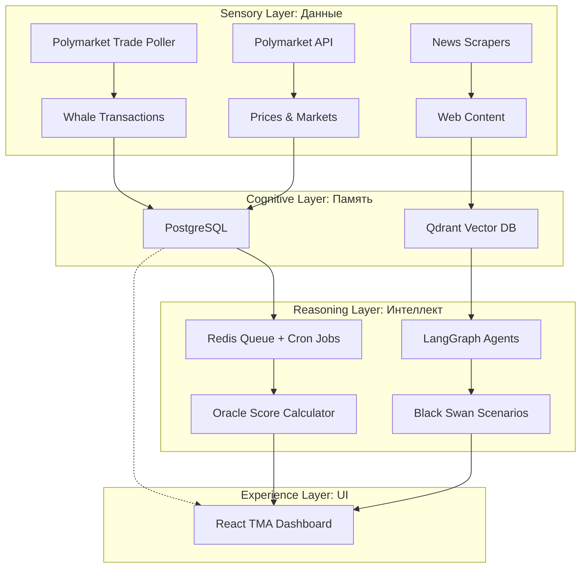

# архитектура OraclePoly: Cognitive Layered Architecture

OraclePoly спроектирован как многослойная когнитивная система, где каждый слой отвечает за определенную стадию обработки информации: от сбора "сырых" сигналов до принятия экспертных решений ИИ.

---

## 🏗️ Обзор слоев

---

## 🔍 Подробное описание

### 1. Sensory Layer (Сенсорный слой)
Отвечает за захват внешних сигналов.
- **Polymarket Trade Poller:** Периодический опрос API Polymarket для обнаружения транзакций "китов".
- **Firecrawl / Serper:** Автоматический поиск и скрапинг новостных статей по тематике рынков.
- **Polymarket Wrapper:** Синхронизация статусов рынков и текущих цен.

### 2. Cognitive Layer (Когнитивный слой)
Обеспечивает хранение и поиск информации.
- **PostgreSQL 16 (asyncpg):** Хранение структурированных данных (пользователи, транзакции, рынки). Используется тип `NUMERIC(20, 6)` для обеспечения финансовой точности USDC.
- **Qdrant:** Векторная база данных для семантического поиска. Позволяет находить новости, наиболее релевантные конкретному рынку, с помощью OpenAI Embeddings.

### 3. Reasoning Layer (Слой рассуждений)
Ядро системы, где происходит анализ.
- **Oracle Engine:** Рассчитывает `Oracle Score` по формуле:
  `S = α·Sentiment + β·WhaleWeight - γ·RiskImpact`
- **LangGraph (Black Swan Agent):** ИИ-агент с "пессимистичным" настроем, который ищет в новостях сигналы, противоречащие ставкам китов, и формирует сценарии риска.
- **Redis Queue (`scripts/oracle_worker.py`):** Гарантирует надежность обработки транзакций через систему очередей и повторных попыток (retries). Scheduled jobs выполняются через `scripts/cron_runner.py`.

### 4. Experience Layer (Слой опыта)
Взаимодействие с пользователем.
- **Cyber-Oracle UI:** Интерфейс на React 19, оптимизированный под Telegram Mini App.
- **Realtime:** Использование WebSockets через PostgreSQL NOTIFY/LISTEN (pg_notify) для мгновенного отображения новых транзакций китов без перезагрузки страницы.

---

## 🛡️ Принципы проектирования
1. **Idempotency:** Каждая транзакция обрабатывается ровно один раз благодаря уникальным ключам `tx_hash` + `log_index` и дедупликации в Trade Poller перед отправкой в Redis Queue.
2. **AI Hallucination Guard:** Семантическое соответствие новостей проверяется с порогом `0.85` перед тем, как повлиять на Oracle Score.
3. **Pessimistic Analysis:** Система всегда ищет "скрытый риск", чтобы сбалансировать оптимизм рыночных цен.

---
*Документ подготовлен AI-ассистентом Antigravity.*
