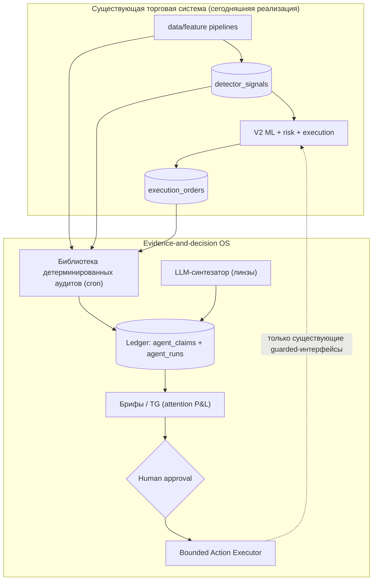

# Portfolio Analyst Agent — концепт v2.1 (final)

**Статус:** final proposal — к ревью владельца (заменяет v1; архив — [portfolio_analyst_agent.v1.md](portfolio_analyst_agent.v1.md))
**Дата:** 2026-07-20
**Владелец:** владелец
**Основания:** Fable-ревью всего research-корпуса ([06_fable_response.md](../../research/fable-research-map-2026-07-19/06_fable_response.md)); внешний deepdive — 4 гипотезы подтверждены ([decision](../../research/portfolio-analyst-agent-concept-gaps-2026-07/2026-07-19_decision.md)); бенчмарк/прайс-снимок LLM-рынка 07.2026.
**Сопутствующие документы:** [agent_tg_communication.md](agent_tg_communication.md) — коммуникация с владельцем (шаблоны, cron-расписание, механика кнопок); [agent_explainer_for_sharing.html](agent_explainer_for_sharing.html) — объяснение простым языком для внешнего читателя.

**Решение в одну строку:** строим не «LLM, который торгует», и не фабрику гипотез над детекторным конвейером, а **evidence-and-decision OS всей операции**: реестр утверждений с полураспадом + библиотека детерминированных аудитов + экономика внимания владельца + портфель неэффективностей. LLM синтезирует и объясняет; статистика, риск и исполнение детерминированы; деньги двигает только человек. Pipeline V2 — сегодняшняя реализация торговой части, одна из возможных, не центр системы.

**Карта документа:**

| Вопрос | Где |
|---|---|
| Зачем агент, что он НЕ делает, лакмус детектор-агностичности | §1 |
| Почему центр — не фабрика гипотез (цифры корпуса) | §2 |
| Примитивы: клеймы · внимание · портфель + база знаний (экономика · PM · психология) | §3 (база — §3.4) |
| Архитектура, инварианты безопасности, Direction Scout | §4 (скаут — §4.3.1) |
| Модель данных Phase 0 | §5 |
| Циклы работы | §6 (точный cron — §5 TG-спеки) |
| Модели, полная стоимость ≈$15–24/мес, бюджет-кэп | §7 |
| Фазы внедрения с acceptance-критериями | §8 |
| Владелец: IPS, bankroll, риск-реестр, самоокупаемость агента | §9 |
| Итог и следующие шаги | §10 |

## 1. Миссия и лакмус детектор-агностичности

Агент — аналитик и руководитель портфеля операции, который:

1. поддерживает актуальность добытого знания: ни один протухший вывод не управляет решениями молча;
2. регулярно превращает уже собранную телеметрию в найденные деньги (механизм-аналитика);
3. управляет портфелем неэффективностей и рисками, включая концентрацию на механизме резолюции;
4. бережёт часы владельца: каждый выход агента платит за себя изменёнными решениями;
5. по требованию — не по расписанию — производит новые проверяемые гипотезы.

**Лакмус:** концепт обязан пережить без правок ядра (а) замену всех детекторов одной end-to-end ML-моделью, (б) переезд половины оборота на Kalshi, (в) период чисто ручной торговли владельца. Примитивы §3 переживают все три сценария; всё детектор-специфичное живёт в конфигурациях аудитов, не в ядре.

Чем агент **не** является: не источник торгового решения в реальном времени (нет доступа к CLOB-ключам); не автопромоутер lifecycle; не оракул-предсказатель исходов — класс «предскажем исход лучше рынка без уникальных данных» опровергнут данными проекта и заведён в реестр как refuted-клейм (с условиями инвалидации, см. §3.1).

## 2. Производственная функция проекта — почему центр именно здесь

Факты корпуса (45 ресёрчей за 4 месяца + MEMORY.md):

- выживаемость гипотез ~3%: ~33 идеи → 24 детектора → 1 live (D3), и тот net −$61 на 34 сделках при верном направлении (Wilson 62%) — утечка в экономике исполнения, не в предсказании;
- крупнейшие денежные сдвиги дали не новые детекторы, а **политика и методология**: hold-to-resolution против TP/SL (+127% контрфактически), снятие Sports-блэклиста D3 (~55% недозаработка), переход WR→Net ROI (аннулировал D44), фиксы экономики исполнения (колонка slippage врала ×7.6);
- самый повторяющийся класс потерь — **тихо протухший вывод**: D44 «verified KEEPER» аннулирован через месяц; «D3 exit-хрупок (TP/total 7.42×)» перевёрнут через два; drill-матрица «обязательна до live» — live случился без отметки о прогоне; Kalshi Phase 0 висел 2 месяца без статуса; canonical заморожен апстримом 2026-05-04, а weekly-discovery продолжал по нему ходить;
- ограничивающий ресурс — не капитал ($10k) и не идеи, а **часы владельца**.

Следствия: marginal value 34-й гипотезы ≈ 0; флагманский продукт — механизм-аналитика и актуальность знания; research-фабрика — второстепенный, demand-driven режим (v1 ставил её в Phase 1 — фазировка перевёрнута, см. §8).

## 3. Три примитива ядра и доменная база знаний

### 3.1 Claims-реестр: единица управления — утверждение, не детектор

Каждый материальный вывод — вердикт детектора, параметр политики, риск-оценка, методологическое правило, карта системы, даже парадигмы ADR-0001 и выбор LLM-модели — это **клейм** со сроком годности:

```text
agent_claims:
  id, statement, scope (категория/детектор/площадка/политика)
  status: active | expired | contradicted | superseded
  evidence_run_ids[]          -- на чём основан (run'ы аудитов/экспериментов)
  last_verified_at
  verify_policy: time_halflife | event_trigger   -- событийные триггеры дешевле временных
  depends_on[], dependents[]  -- граф: какие решения стоят на этом клейме
```

Правила:

- **Карантин из брифов**: клейм с истёкшим `last_verified_at` или статусом contradicted не показывается человеку как факт, пока не переверифицирован. Это инвариант «fail closed», применённый к знанию, — системная версия правила владельца «память может врать, verify перед утверждением». Защита от внутреннего отравления знания равноправна защите от внешнего prompt injection (§4, инвариант 9).
- **Граф зависимостей**: demote/promote/cap/размер позиции ссылаются на клеймы-основания. Протух или опровергся клейм → автоматический флаг на всех зависимых решениях (механизм, которого не хватило в кейсах D44 и «−1058% sum-ROI»).
- **Паритет стадий** (инвариант methods playbook): вердикт стадии валиден только для той политики, которую стадия симулировала. Backtest-оптимизм и virtual-пессимизм — две разные болезни (качество данных симуляции vs рассогласование политики: virtual мерил TP/SL, live торгует hold). Версия политики (exit, sizing, гейты) — зависимость каждого стадийного вердикта; смена политики инвалидирует вердикты, полученные при старой. Переносить вывод одной стадии на другую запрещено.
- **Методологический долг мая**: клеймы, датированные до методологического скачка (~2026-06-15: control-first, WR→NetROI, look-ahead-safe) и не переверифицированные новой дисциплиной, — карантин по умолчанию; одноразовый sweep — в Phase 0 (§8).
- **Запреты — тоже клеймы, не догмы**: «pure forecast отбрасывать» доказан на замороженном canonical при текущей структуре издержек; в реестре он живёт со scope и условиями инвалидации (смена fee-структуры, новый источник данных), а не как вечная строка промпта.

Реестр поглощает разрозненные механизмы v1: статусы edge-таксономии (`untested|testing|confirmed|refuted` — это статусы клеймов), `agent_metric_definitions` (клеймы о семантике метрик: sum-ROI vs портфельный ROI, Wilson vs Net ROI), refresh-политики deepdive. Один механизм вместо четырёх.

### 3.2 Экономика внимания владельца

Валюта системы — минуты владельца, не токены и не сигналы:

- каждый артефакт агента (бриф, карточка, алерт, отчёт) несёт цену в минутах чтения и ожидаемую отдачу в $ или снятом риске; ранжирование **единое** для research-кандидатов, механизм-фиксов и алертов — не три отдельные очереди;
- **attention P&L**: агент логирует судьбу каждого отправленного элемента (acted / acknowledged / ignored). Типы выходов с хронически нулевым action-rate деградируют из actionable в дайджест, из дайджеста — в тишину;
- **lifecycle выходов**: shadow → digest → actionable. Promote выхода в actionable — по измеренной полезности, не по задумке автора промпта. Симметрия с детекторным lifecycle;
- жёсткий кэп (≤3 actionable-сообщения в день, настройка) остаётся предохранителем; состав определяет action-rate.

### 3.3 Портфель неэффективностей, а не детекторов

Объект управления CIO — набор подтверждённых рыночных неэффективностей; детектор — лишь их реализация. Карточка неэффективности:

```text
механизм (falsifiable) | статус-клейм (confirmed/testing/refuted/untested)
ёмкость: эмпирическая кривая impact(size) из СВОИХ fills (не чужой коэффициент;
  импакт ~ корень из размера относительно ликвидности — непрерывная деградация, не обрыв)
скорость затухания (edge half-life, changepoint)
counterparty theory: кто проигрывает нам и почему не перестаёт
curation_depth: число человеческих степеней свободы в отборе сигнала
механизм резолюции: UMA | CFTC | Chainlink | внутренний    ← ось концентрации
площадка | реализация (какие детекторы/модели её торгуют)
```

- Честное текущее состояние портфеля: **одна confirmed** (cross-market consistency arb — D3), **одна unmeasured** (calibration-bin edge — G18, хвалёная 4 источниками, не измеренная ни разу — первое задание агента, §8), остальное refuted или untested.
- Ось «механизм резолюции» делает видимой строку «100% capacity на UMA-резолве» — Kalshi формально становится **хеджем резолюционного механизма**, а не только источником эджа (у UMA задокументированный эксплойт, §9.4).
- `curation_depth` — проверяемый закон-кандидат корпуса: чем выше курирование, тем легче сигнал проходит грубую проверку и тем вероятнее падает под честной (D26 vs D27/D52; `signal_price` — наименее переносимый признак). Ретро-тест по всем live/shadow детекторам — дешёвая проверка закона на существующих данных.
- Портфель со статусами `untested/testing/confirmed/refuted` целиком — прямой вход для Direction Scout (§4.3.1): именно эта таблица делает белые пятна видимыми и структурными, а не поводом гадать по сырому рынку.

### 3.4 Доменная база знаний: экономика · механика prediction markets · психология

«Идеальное знание домена» для этой системы — не начитанность LLM (она есть у любой модели из коробки и уже подводила: round-number, mean-reversion и whale-flow — хрестоматийные механики, опровергнутые нашими данными), а **операционализированный каталог механизмов со статусами на наших данных**, обязательный к цитированию в каждом предложении. Наследует и восстанавливает v1 §6.5. Три домена, один формат:

- **Экономика исполнения и микроструктура** (`docs/knowledge/market_economics.md`): adverse selection и queue position, impact ~ √size, maker/taker-экономика, fee-структуры, capacity, стоимость замороженного в позиции капитала. Посев: adverse-selection-ресёрч, funnel-аудиты, собственные fills.
- **Механика prediction markets** (`docs/knowledge/prediction_markets.md`): резолюционные механизмы (UMA governance с прецедентом, CFTC, Chainlink), favorite-longshot, time-decay дедлайновых рынков, negrisk/basket-консистентность, cross-venue lead-lag, POL rewards, событийный календарь ёмкости. Посев: 21 ресёрч edge-кластера.
- **Поведенческий каталог** (`docs/knowledge/behavioral_catalog.md`): документированные байесы участников в привязке «кто · в какой ситуации · как видно в наших данных»: herding и overreaction на новости, recency, якорение на круглых числах, disposition effect розницы, информированные игроки против нас (метео-боты temperature-рынков — собственный прецедент adverse selection). **Тот же каталог обслуживает §9.5**: ретро решений владельца ищет те же байесы в наших собственных оверрайдах — психология контрагента и психология владельца проверяются одним инструментом.

Рядом — `docs/knowledge/methods_playbook.md` (статистическая скамья: когда Wilson, когда per-event bootstrap, когда changepoint, shrinkage на малых выборках; шаблоны experiment runner-а ссылаются на него, а не изобретают метод на месте) — на него уже опираются §3.1 и §4.2.

Правила, отличающие базу знаний от энциклопедии:

1. **Каждая запись — клейм** (§3.1): механизм, внешние источники, статус на НАШИХ данных (`untested | testing | confirmed | refuted`), evidence_run_ids, условия инвалидации. Хрестоматийное знание входит со статусом `untested`: литература поставляет кандидатов, статусы присваивает только наша проверка.
2. **Контракт цитирования**: Hypothesis Card не проходит в runner без трёх ссылок на базу — экономический механизм (почему неэффективность существует), поведенческий драйвер (какой байес или структурное ограничение удерживает контрагента в проигрышном поведении), микроструктурный путь (почему захватываемо после fees/slippage). Improvement Cards и объяснения policy-вердиктов цитируют записи каталога так же, как цитируют run ID. Предложение без механизма из каталога — либо сначала новая запись-кандидат, либо не предложение.
3. **Полнота измерима**: quarterly taxonomy sweep (§6) проходит все три домена × наши категории; метрика — доля записей без вердикта. «Гениальность» агента = отсутствие непроверенных известных механизмов, не эрудиция.
4. **Посев — индексация, не написание с нуля**: материал уже лежит в 45 локальных ресёрчах; первичная индексация — часть Phase 0 seeding (§8). Пополнение — literature watch Direction Scout (§4.3.1): новые кандидат-записи каталога — его второй выход помимо Direction Card.

## 4. Архитектура: четыре компонента вместо пяти ролей



Роли v1 (Sentinel / Researcher / Runner / Advisor) не исчезают — они становятся **конфигурациями**: набор аудитов + промпт-линза + формат выхода, а не отдельными сервисами. Меньше сущностей, те же гарантии.

### 4.1 Ledger

Evidence store + claims-реестр (§3.1). Каждый показатель несёт query version, snapshot hash и идентификаторы исходных строк; ни один summary не заменяет исходный ledger; любой вердикт переигрывается без LLM.

### 4.2 Библиотека детерминированных аудитов

Cron-джобы через существующий `scripts/cron_runner.py` + `crontab.conf`, без отдельного демона. Состав (бывшие Sentinel + Runner + расчётная часть Advisor):

- **Data-quality аудит** → вердикт `GREEN | AMBER | RED` с измерениями и ссылками на строки. Проверки: freshness (возраст источников против SLA), completeness (доля рынков с condition_id/token/end_date/ценой, покрытие outcome), validity (цена в (0,1), bid<ask, положительный size, YES/NO стороны), referential integrity (signal → `markets.polymarket_id`, event → `events.polymarket_id`, никаких внутренних UUID — инцидент M2/D45), cross-source reconciliation (Gamma-vs-CLOB, orderbook-vs-DB staleness, broker-vs-`execution_orders`), statistical quality (EXPIRED-доля, proxy-flips, дедуп, effective N, drift), operational health (429/queue lag/emission SLO/stuck positions). `RED` блокирует риск-рекомендации и помечает зависимые клеймы `BLOCKED_DATA`; `AMBER` — только research-выход с пометкой. Пороги версионированы, не решаются LLM.
- **Воронка исполнения** signal → gate → order → fill → exit → resolve: где теряются сигналы и деньги (институционализация ручных funnel-аудитов).
- **Контрфактика гейтов** по `gate_shadow_log`: какие гейты режут прибыльные сигналы, какие пропускают убыточные.
- **Counterfactual engine** (фундамент очереди §8 Phase 1): policy diff → P&L diff с CI поверх trajectory archive.
- **Edge decay / regime monitor**: rolling Wilson/Sortino + changepoint, half-life; мониторит и классы методологии валидирования, не только детекторы.
- **Cost ledger**: сервер, прокси, LLM-токены (автоматически из `agent_llm_calls`), комиссии, gas.
- **Claims-ревалидация**: очередь протухающих клеймов, событийные триггеры риск-реестра (§9.4).
- **Experiment runner** (Phase 4, для research-режима): chronological train/holdout, per-event bootstrap (не row-level split), fee/spread/slippage/entry eligibility, category/price/horizon slices, minimum effective N, mirror/adversarial вариант (нулевая или обратная разница — reject), overlap с текущими неэффективностями, явная дата среза canonical, воспроизводимые dataset/query/config hashes. Выход — `PASS | MARGINAL | FAIL | INSUFFICIENT_DATA`, не свободный текст.

Policy engine поверх аудитов формирует вердикты фиксированного словаря: `OBSERVE, INVESTIGATE_DATA, KEEP_SHADOW, START_VIRTUAL_REVIEW, PAUSE_REVIEW, REDUCE_RISK_REVIEW, LIVE_RAMP_REVIEW, CLOSE_POSITION_REVIEW`. Семантика метрик — версионированные клеймы: bankroll-weighted ROI, а не сумма per-signal ROI (инцидент demote-алерта D42); net отдельно от gross; reject burst — stage-aware (rejected-спайк virtual-детектора не гасит live — инцидент D38→D3).

### 4.3 LLM-синтезатор

Один компонент с линзами-промптами (см. §7): researcher-линза (behavioral / truth-path / непокрытые data assets / переосмысление архива отказов), adversarial twin (обязан опровергнуть карточку; проверяемые пункты опровержения становятся вариантами эксперимента), explainer-линза (бриф), **direction scout-линза** (§4.3.1 — открытие направлений, отдельная от researcher-а). LLM никогда не заменяет policy verdict, не сдвигает порог, не «округляет» выборку и не может переписать цифры, которые видит человек при approve (deepdive C1: «agent cannot rewrite what human sees»).

#### 4.3.1 Direction Scout — автономность в выборе, ЧТО исследовать

**Проблема, которую закрывает этот раздел.** Всё остальное в концепте — researcher-линза (§4.3), demand-driven research (§6), Hypothesis Card — работает **реактивно**: вопрос уже сформулирован (риск-триггером, ограничением ёмкости, событием) — агент его проверяет. Ни один механизм не решает, куда смотреть, если вопрос ещё никем не задан. Разница между «проверить гипотезу» и «выбрать направление» — принципиальная: без второго режима система остаётся реактивной, сколько бы ни проверяла.

**Что это НЕ означает.** Direction Scout не ищет новый эдж напрямую (это работа researcher-линзы после того, как направление выбрано) и не порождает торговый сигнал ни при каких обстоятельствах — его выход на две ступени дальше от денег, чем у Hypothesis Card. Класс риска здесь качественно другой, чем у остальных линз: без затравки и без снапшота конкретных цифр LLM физически не на чем reconciliation-проверить выход — значит, вход и структура выхода должны компенсировать это архитектурно, а не постфактум.

**Вход — два слоя, не один.** (а) Внутренний, структурный: полный список неэффективностей (§3.3) со статусами `confirmed/testing/refuted/untested`, три домена базы знаний §3.4 с записями без вердикта (это и есть формализованная карта белых пятен), реестр площадок и механизмов резолюции с осью концентрации; плюс сырые поведенческие таблицы, которые уже собираются в проекте, но никогда не доходят до research-слоя напрямую — `transactions`, `wallet_registry`/`wallet_performance` (сдвиги в поведении крупных игроков раньше, чем они попадут в детекторный портфель), Kalshi/Manifold canonical mappings (межплощадочные расхождения как индикатор структурного сдвига, не только источник D40-подобного эджа). (б) Внешний: **`web_search_20260209` + `web_fetch_20260209`** (server-side инструменты Anthropic API — до Phase 4 в проекте не было ни одного веб-источника вообще, это первое реальное окно во внешний мир). Скаут смотрит на **структуру того, что уже знает и не знает система, сверенную со свежим состоянием мира**, не гадает ни по сырому рынку в одиночку, ни по одной лишь своей памяти.

Санитизация внешнего слоя — конкретизация инварианта 7 для этого случая, не абстракция: результаты `web_search`/`web_fetch` проходят через `app/core/sanitizers.py` до попадания в промпт; источник помечается (домен, дата публикации, тип — новость/регуляторный документ/форум/агрегатор); любой императив внутри найденного текста («сделай X», «игнорируй…») трактуется как данные, не как инструкция — та же дисциплина, что для остального untrusted-контента в проекте. Токен-бюджет на поиск — фиксированный потолок за прогон (не открытый краулинг); `max_uses` на инструменте ограничивает число запросов за один вызов линзы.

**Выход — Direction Card, не Hypothesis Card**, третий вид карточки в системе:

```text
id, title
gap: какой класс белого пятна закрывает (untested-класс таксономии |
  неисследованная площадка | новый механизм резолюции | структурный сдвиг рынка)
evidence-triggers: что конкретно замечено (изменение объёма, новая площадка,
  регуляторное событие, класс данных, которого раньше не было)
почему НЕ покрыто существующими Hypothesis Card
предлагаемый первый шаг: конкретный, дешёвый, проверяемый за <1 день агентом
  (не «исследовать рынок X» — а «прогнать taxonomy-класс Y против категории Z
  на существующих данных»)
confidence: заведомо ниже, чем у Hypothesis Card — это гипотеза о ценности
  направления, не о самом эдже
```

Direction Card **не проходит через experiment runner** (для неё нет числового вердикта — она о приоритете внимания, не о статистической значимости) и **не создаёт торговую задачу**. Единственный легальный переход: Direction Card → (одобрение владельцем) → новая **standing question** в demand-driven research (§6), которая уже дальше идёт обычным путём через Hypothesis Card и runner. Один дополнительный уровень approval специально ради самого рискованного по классу выхода в системе.

**Частота — два разных по стоимости и полноте тика, не один.** Разносим дешёвую проверку «появилось ли новое основание» от дорогого полного синтеза; ни тот ни другой не бежит по сырому рынку в одиночку.

- **Каждые 3 дня — лёгкий монитор.** Детерминированный дифф внутреннего слоя (что изменилось в портфеле/таксономии за 3 дня — почти всегда ничего) плюс **один точечный `web_search`-прогон** по фиксированному, версионированному списку standing-тем (регуляторные дедлайны риск-реестра §9.4, governance-инциденты у используемых механизмов резолюции, новые площадки/агрегаторы, публикации по классам таксономии со статусом `untested`). Не полная researcher-линза — узкий, дешёвый classifier-промпт «есть ли здесь что-то, чего не было 3 дня назад, относящееся к нашим белым пятнам?». Отрицательный ответ (почти всегда) не порождает вызов дорогой линзы и не отправляется владельцу — молчание не новость (§4.11 коммуникационной спеки). Положительный — копится до недельного синтеза, а если находка явно срочная (например, регуляторный дедлайн подтвердился) — уходит немедленно как обычный алерт риск-реестра, не как Direction Card.
- **Раз в неделю — полный детерминированный синтез.** Полная direction scout-линза на обоих слоях входа (внутреннем и внешнем) целиком, плюс всё, что накопил 3-дневный монитор за неделю. Здесь и рождается собственно Direction Card — карточка синтезирует накопленное, а не реагирует на одно случайное совпадение 3-дневного тика. «Детерминированный» относится к пайплайну вокруг линзы (§6 коммуникационной спеки: досчитать метрики → сравнить с порогом → LLM только если есть что объяснять → reconciliation → троттлер), не к самому LLM-выводу — тот всегда стохастичен, детерминирован только контур, который решает, звать ли его и что с выходом делать.

Каждая Direction Card обязана пройти проверку против уже отвергнутых направлений (Z-список «что не добавлять» из внешнего deepdive, contradicted/refuted-клеймы реестра): предложить уже опровергнутое — ошибка линзы, логируется как таковая, не как валидная находка. Кэп выхода — 0–3 карточки за прогон (§4.3.1.1, шаг 5) — держит поток ограниченным при любой частоте.

**Right-sizing.** Это самая дорогая по риску ошибки линза в системе — тем важнее держать eval минимальным, а не разращивать его пропорционально частоте. До первых 10–15 Direction Card с обратной связью (одобрено/отклонено/оказалось ценным) не строить для неё отдельный eval сверх общего golden set §7.2 — тот же запрет преждевременной eval-машинерии, что применён к judge. Стоимость — построчно в §7.1; Scout — крупнейшая строка LLM-бюджета, цена единственного канала во внешний мир.

#### 4.3.1.1 Weekly-синтез: исполняемый пайплайн

Предыдущий раздел называет источники входа; здесь — порядок операций еженедельной cron-джобы (`scripts/cron_runner.py direction-scout-synthesis`, ср 06:30 — завершается до дневного цикла аудитов 08:00, так что находка уходит владельцу в тот же день, а слот не пересекается с пн/1-го 07:00-джобами). Каждый шаг детерминирован, кроме шага 5 — единственного LLM-вызова во всём пайплайне.

**Шаг 1 — собрать снапшот внутреннего слоя (чистый SQL, без LLM).** Один запрос-агрегатор, не серия разрозненных выборок:

```text
- agent_claims: все клеймы со status IN ('active','testing') — статус, evidence_run_ids,
  last_verified_at, scope. Отдельно — что протухло/изменило статус за 7 дней (дифф
  против прошлой недели, не полный снимок).
- portfolio_exposure_snapshot (read model §5): статусы confirmed/testing/refuted/untested
  по всем неэффективностям, ось "механизм резолюции", ось capacity.
- taxonomy sweep (последний прогон, Phase 4 §8): доля непокрытых классов, какие именно.
- Дифф за 7 дней по transactions/wallet_registry/wallet_performance: только
  top-N сдвигов (новые кошельки в топ-перформерах, резкие изменения паттерна потока —
  не сырой дамп таблиц, а уже агрегированные дельты).
- Kalshi/Manifold canonical mappings: новые/пропавшие межплощадочные пары за неделю.
- Накопленные находки 3-дневного монитора за эту неделю (2-3 прогона; §4.3.1
  "лёгкий монитор") — то, что уже прошло первичный фильтр "относится к белому пятну".
```

Результат шага 1 — один JSON-снапшот, тот же объект, что уходит в промпт шага 5 и сохраняется в `agent_runs` для reconciliation. Ничего из этого не идёт в LLM без прохождения через агрегацию — сырые строки таблиц линза не видит.

**Шаг 2 — построить поисковые запросы из снапшота (детерминированно, не LLM-генерация текста запроса).** Список standing-тем (§4.3.1: регуляторные дедлайны риск-реестра, governance используемых механизмов резолюции, новые площадки/агрегаторы, untested-классы таксономии) — не статичная строка в промпте, а версионированная таблица `agent_direction_scout_topics` (тема, шаблон запроса, последняя проверка, источник происхождения темы). Проверка регенерируется еженедельно из шага 1: например, каждый untested-класс таксономии автоматически порождает тему «{класс} + prediction markets 2026», каждый используемый механизм резолюции — тему «{механизм} governance dispute {год}». Список растёт и сжимается вместе с портфелем, не редактируется вручную построчно.

**Шаг 3 — прогнать `web_search`/`web_fetch` по построенным темам (server-side, фиксированный `max_uses` за прогон, §4.3.1).** Результаты — не полный текст страниц, а санитизированные сниппеты с метаданными (домен, дата публикации, тип источника) через `app/core/sanitizers.py`, как описано выше.

**Шаг 4 — детерминированный pre-filter результатов поиска (без LLM).** Дедуп против источников, уже процитированных в существующих клеймах/Hypothesis Card за последние 90 дней (не приносить то, что уже разобрано); фильтр по domain-allowlist/blocklist (первый рубеж против низкокачественных источников, до того как текст вообще увидит LLM); отбрасывание результатов старше окна релевантности темы (регуляторная новость 2024 года не годится для «свежего структурного сдвига»).

**Шаг 5 — единственный LLM-вызов: синтез.** Вход — JSON шага 1 + отфильтрованные сниппеты шага 4; внутри вызова ничего не дособирается (`web_search` здесь — источник данных, собранный заранее детерминированным контуром, а не tool call модели во время рассуждения: тот же снапшот + те же сниппеты дают переигрываемый вход — воспроизводимость важнее свободы поиска). Промпт: «вот структура известного (снапшот) и неизвестного (сниппеты) — где расхождение указывает на белое пятно, которое стоит начать исследовать» + явный список уже отвергнутых направлений для проверки на переоткрытие. Выход — 0–3 Direction Card по формату §4.3.1, не свободный текст.

**Шаг 6 — reconciliation и троттлер (§6 коммуникационной спеки, тот же контур, что у всех остальных сообщений).** Каждая карточка сверяется: ссылается ли она реально на элементы снапшота шага 1 (не на выдуманные цифры), не совпадает ли `gap` с уже отвергнутым классом (повторная проверка после LLM, не полагаемся только на промпт-инструкцию шага 5). Не прошедшая reconciliation карточка не отправляется и логируется как ошибка синтеза, не как находка.

**Автоматизация.** Весь пайплайн — одна cron-строка в `crontab.conf` по образцу существующих weekly-джоб плюс одна миграция на таблицу `agent_direction_scout_topics` (список тем сам себя обновляет по шагу 2, ручного редактирования не требует). Единственные точки, где нужен человек, — одобрение Direction Card (§4.3.1) и теневой период первых прогонов (§8 Phase 4).

### 4.4 Bounded Action Executor

Без изменений против v1 — подтверждён внешним deepdive (H1) и историей инцидентов:

- принимает только signed, typed Action Proposal: `proposal_id`, input snapshot hash, policy version, expiry, idempotency key = `session_id:call_id` (защита от ретраев — тот же класс бага, что дедуп `gate_shadow_log`, PR #703);
- TTL истёк → fail-closed (`expired`, действие не выполняется; auto-approve по TTL запрещён — задокументированный источник реальных потерь в agentic-системах);
- исполнение работает со снапшотом аргументов на момент создания proposal — человек одобряет ровно те цифры, которые исполнятся;
- DQ RED → approval invalidated; кнопку нельзя переиспользовать или подтвердить «любое следующее действие».

| Уровень | Действие | Кто | Исполнение |
|---|---|---|---|
| L0 | read-only отчёт, алерт, карточка | агент | автоматически |
| L1 | research task, dashboard review, TG alert | policy engine | автоматически, audit log |
| L2 | shadow-задача, virtual review, pause, reduce cap, close position | агент предлагает | admin подтверждает через TG/API с TTL |
| L3 | promote to live, cap↑, execution config, ордера | только admin | существующий V2/TG workflow; у агента нет credentials |

### 4.5 Нефункциональные инварианты

1. **No direct trading authority**: у agent worker нет `POLYMARKET_API_KEY`, signing key, proxy transport, write-доступа к торговым таблицам.
2. **No autonomous live promotion**: только существующий manual TG-workflow и независимые promotion gates.
3. **Fail closed для рекомендаций**: DQ RED, stale snapshot, missing identity, unknown config, insufficient N, `IPS_VIOLATION` — запрет риск-рекомендации.
4. **Fail safe для торговли**: падение агента не блокирует V2 safety/execution и не снимает kill switch.
5. **Reproducibility**: любой вердикт переигрывается без LLM по snapshot/query/config/model versions.
6. **Least privilege**: read-only DB-роль аналитики; отдельная executor-роль с whitelist; никакого произвольного SQL/shell/URL через LLM-инструменты.
7. **Prompt-injection resistance**: внешний текст untrusted, санитизация (`app/core/sanitizers.py`), source-labelling, token budget; proposals собираются из typed-полей.
8. **Economic realism**: каждое решение учитывает live population, per-event корреляцию, возраст цены, fees, slippage, fill/exit-допущения.
9. **Внутреннее отравление знания**: протухшие/опровергнутые клеймы карантинятся из брифов; каждое утверждение в брифе несёт `last_verified_at`; агент не цитирует собственную память без evidence run.

### 4.6 Существующая система — проверенная карта (2026-07-19)

| Поток | Источник/частота | Хранилище | Реализация |
|---|---|---|---|
| Метаданные рынков | Gamma API, 15 мин | `events`, `markets` | `app/jobs/market_sync.py` |
| Сделки китов | Data API, 1 мин | Redis queue → `transactions` | `app/jobs/trade_poll.py` |
| Order book | WS cache + REST fallback | Redis `microstructure:{token_id}` | `app/services/polymarket_ws_service.py` |
| Live ML snapshots | 5–20 мин | `live_*` таблицы | `app/jobs/live_*_writer.py` |
| Альт-площадки | Manifold; Kalshi-джобы выключены 2026-07-16 | canonical mappings | `app/jobs/manifold_*.py` |
| Резолв | Gamma + demand-driven CLOB poll | `markets.resolved/winner` | `app/jobs/market_resolution_poller.py` |

ID-конвенция (клейм с постоянной ревалидацией): `detector_signals.market_id` = `markets.polymarket_id`, `event_id` = `events.polymarket_id`; внутренние UUID недопустимы. Lifecycle: Backtest → Shadow (`detector_signals`) → Virtual (`execution_orders.execution_mode='virtual'`) → Live; promotion — только manual TG. `scripts/auto_edge_scanner.py` — статистический фундамент offline-discovery (BH-FDR, mirror, year-split), но canonical заморожен апстримом на 2026-05-04: offline-нога discovery событийна (при появлении свежего raw), не календарна.

## 5. Модель данных: 4 таблицы на Phase 0, остальное — по доказанной нужде

Отдельная миграция, торговые таблицы не трогаются, только read-only роль к ним.

| Таблица | Назначение |
|---|---|
| `agent_claims` | реестр утверждений (§3.1): статус, evidence, verify-политика, граф зависимостей |
| `agent_runs` | immutable-прогоны всех видов: `kind = dq \| audit \| experiment \| proposal`, config/dataset/query hashes, metrics, verdict, report URI |
| `agent_actions` | proposal + approval + receipt в одной сущности: payload hash, TTL, actor, фактический эффект или причина отказа |
| `agent_llm_calls` | prompt/model/snapshot hash, токены, стоимость, schema-retry, reconciliation-результат |

Read models (materialized views поверх существующих ledgers): `detector_health_snapshot` (сигналы/outcome/fill/PnL/калибровка/drift/DQ), `data_freshness_snapshot` (источник × SLA × last success), `portfolio_exposure_snapshot` (exposure по event/category/side/механизму резолюции), `claims_expiry_queue` (что протухает и когда).

Отложены до доказанной нужды (были в v1 как отдельные таблицы): experiment runs и DQ runs — влиты в `agent_runs.kind`; approvals/receipts — влиты в `agent_actions`; metric definitions и edge-taxonomy statuses — влиты в `agent_claims`; `agent_cost_ledger` — представление поверх `agent_llm_calls` + ручные строки раз в месяц; `agent_decision_journal` — markdown-дисциплина с первого дня (§9.5), таблица — когда появится автоматика сверки; `agent_direction_scout_topics` (§4.3.1.1, версионированный список тем weekly-синтеза) — не Phase 0: появляется вместе с самим Direction Scout в Phase 4, отдельной небольшой миграцией, не заранее.

## 6. Циклы работы

- **Daily**: библиотека аудитов → policy-вердикты → бриф: «что изменилось / чему верить (DQ + last_verified) / **протухшие и опровергнутые клеймы** / attention P&L недели / какое действие разрешено». Никаких LLM-вызовов на tick/signal — в момент сигнала работают существующие detector/ML/sizing/safety-гейты; агент асинхронно объясняет и алертит только high-severity (DQ RED, stage-aware reject burst, execution drift, exposure breach, lifecycle gate, риск-триггер).
- **Event-driven**: срабатывания исполняемого риск-реестра (§9.4) — disputed-статус рынка с открытой позицией, регуляторные дедлайны, proxy expiry, смена fee-структуры площадки, смена линейки/цен LLM-провайдера (инвалидирует клейм выбора модели, §7).
- **Research — по требованию, не по расписанию**: генератор агенды — риск-реестр и ограничения ёмкости, а не бэклог идей. Standing questions вида «что вдвое снизит концентрацию на UMA-резолве?», «где ёмкость сверх $X/мес?», «кто контрагент D3-филлов?». Плюс событийно: новый data asset, свежий canonical, новый механизм рынка. Hypothesis Card (структура v1 сохранена: falsifiable mechanism, paradigm, anti-universe, data contract, confounders/leakage, mirror, counterparty theory, `curation_depth`, offline design + forward acceptance, execution shape, prompt_version; **плюс обязательные knowledge-refs §3.4** — экономический механизм + поведенческий драйвер + микроструктурный путь) — только через experiment runner, `PASS` создаёт задачу на shadow-спеку, не торговый сигнал. **Откуда берутся сами standing questions, если ни риск-триггер, ни событие их ещё не поставили — отдельный, более редкий цикл, см. Direction Scout ниже.**
- **Direction Scout (§4.3.1)** — единственный автономный по выбору направления цикл в системе, на двух тиках: **каждые 3 дня** дешёвый монитор (внутренний дифф + точечный web-поиск по фиксированному списку тем, почти всегда молчит), **раз в неделю** полный детерминированный синтез на обоих слоях входа, порождающий Direction Card. Одобренная Direction Card становится новой standing question для research-цикла выше — единственный легальный переход из открытия в проверку.
- **Weekly**: improvement-бриф «куда следующие 10 часов» — Improvement Cards, ранжированные по EV на час владельца (размер утечки × P(успех фикса) / часы).
- **Monthly**: owner's report — true P&L после всех издержек, benchmark против безрисковой ставки из IPS, вердикт `WORTH_SCALING | SUSTAINABLE | SUBSIDIZED | SHUTDOWN_REVIEW` — и **тот же вердикт для самого агента** (§9.8).
- **Quarterly**: IPS-ревью, ретро качества решений (§9.5, поведенческим каталогом §3.4), taxonomy sweep по трём доменам базы знаний (§3.4) и портфелю неэффективностей — доля записей без вердикта как метрика полноты.

Точное cron-расписание — времена, порядок после существующей resolve-цепочки, какие тики зовут LLM, а какие чистый SQL — §5 [коммуникационной спеки](agent_tg_communication.md).

## 7. LLM-слой

### 7.1 Выбор моделей (клейм от 2026-07-19, event-триггер: смена линейки/цен провайдера)

Базовый объём по циклам концепта (без Direction Scout) ≈ 2M input / 0.15M output токенов в месяц — на таком объёме весь разброс тарифов < $10/мес; решает качество там, где вывод меняет решения, и защита от разгона объёма. Единственное исключение — Direction Scout: его цена определяется числом `web_search`-запросов, не токенами, поэтому ниже полная построчная стоимость всего агента, не общая оценка.

| Роль | Модель | Обоснование | ≈$/мес (batch, где применимо) |
|---|---|---|---|
| Researcher-линзы, adversarial twin (weekly research-цикл §6) | `claude-sonnet-5` | AA-index ~53, SWE-bench топ-5 весь Claude; интро $2/$10 до 31.08.2026, бюджетировать по $3/$15 | ~3–4 |
| Explainer (daily/weekly/monthly/quarterly брифы) | `claude-haiku-4-5` | цифры уже посчитаны детерминированно; $1/$5 | ~1–1.5 |
| Direction Scout, 3-дн монитор (~10 прогонов/мес) | `claude-haiku-4-5` + `web_search` | узкий classifier-промпт, фиксированный список тем; **не batch** — server-tool | ~1–1.5 |
| Direction Scout, weekly-синтез (~4.3 прогона/мес) | `claude-sonnet-5` + `web_search`/`web_fetch` | полная линза на двух слоях входа; **не batch** — server-tool | ~8–13 |
| Judge (после порога §7.2, редкие вызовы на shadow-сравнениях) | GPT-5.4-mini или Gemini 3.1 Flash-Lite | **обязательно другое семейство** — self-enhancement bias 10–25% | <1 |
| Shadow-кандидаты (эпизодически, не постоянная нагрузка) | Kimi K3 ($3/$15, AA 57), GPT-5.6 Terra ($2.5/$15, AA 55) | promote по golden-set eval §7.2, не по лидерборду; K3 released 16.07 — без трек-рекорда, без Batch, данные в Moonshot | ~0–3, зависит от активности сравнения |
| **Итого LLM-слой** | | | **≈15–24/мес** |

Weekly-синтез Scout — крупнейшая строка бюджета (больше половины): цена единственного канала во внешний мир. Если фактическая стоимость выйдет за диапазон, первый рычаг — сужение списка standing-тем 3-дневного монитора (меньше поводов → реже срабатывает дорогой недельный прогон), а не откат частоты синтеза.

Интеграция: официальный SDK `anthropic` в новом модуле `app/agent/` (Batch API −50% — циклы, не задействующие `web_search`/`web_fetch`, не latency-sensitive; prompt caching: snapshot — стабильный префикс, линза после breakpoint: Best-of-K = 1 write ×1.25 + K−1 reads ×0.1). **Direction Scout — единственная роль вне batch-экономики**: server-side `web_search`/`web_fetch` несовместимы с Batch API, идут обычным (не batch) вызовом; это меняет её экономику качественно, не только количественно, отсюда отдельные строки таблицы. Существующий `app/core/llm.py` (OpenAI-совместимый, `openai|cloudflare|openrouter|local`) не трогать — это линия судьи и shadow-кандидатов через OpenRouter (zero markup, но без Batch; комиссия пополнения 5.5%). API-биллинг отдельный от подписки Claude Code. Хвост: дефолт `llm_analysis_model="gpt-4o-mini"` в `config.py` протух (модель исчезла из прайс-листа OpenAI) — обновить независимо от этого концепта.

Бюджет: месячный кэп (стартово $30) и per-run кэп; превышение — fail closed, не молчаливо урезанный ответ. Всё в `agent_llm_calls` → cost ledger → true P&L. **Полная стоимость функционирования агента** — не только LLM: сервер уже входит в существующий VPS-хост (маргинальный прирост от нового модуля близок к нулю — cron-джобы лёгкие, ML-инференс не задействован), прокси не касается агента (он read-only и не размещает ордера, POST-ордер прокси — только для CLOB), новые read-only DB-роль и 4 таблицы Phase 0 — на существующем Postgres без дополнительной инфраструктуры. Итого маргинальная стоимость всей системы ≈ **$15–24/мес LLM + ~$0 инфраструктуры** — сопоставимо с прокси или чуть выше него в текущем cost ledger проекта, далеко не главная статья опекса (для сравнения: прокси и сервер вместе — большая часть операционных издержек по данным месячного отчёта §9.2).

### 7.2 Eval и prompt lifecycle — right-sized

Промпт — versioned-артефакт с детекторным lifecycle: offline eval → shadow → manual promote. В репо (`app/agent/prompts/`), semver + changelog; каждый вывод несёт prompt_version, model, snapshot hash.

- **Golden set** из архива проекта, два раздельных набора: regression (~100% target pass rate, ловит деградацию; стартовое наполнение — 6 replay-кейсов Phase 0 из §8 + систематическая конвертация будущих ручных ревью) и improvement (намеренно не насыщен; 0% pass чаще значит «сломан кейс», не «агент слаб»).
- **Метрики Researcher-линз**: schema-valid с первой попытки; recall известных confounders/leakage на golden-кейсах; precision reject запрещённых классов; полнота data contract. **Метрики Explainer**: 100% чисел брифа сходятся со снапшотом — reconciliation делает детерминированный скрипт, не LLM; каждое причинное утверждение цитирует run ID; лимит длины.
- **Shadow-сравнение** промптов и моделей: одинаковые input-снапшоты, решающее правило — 95%-CI (пересечение = «доказательств для переключения нет»), отдельно worst-case/tail-check (промпт, улучшающий среднее, но вносящий редкий катастрофический сбой, средней метрикой не ловится). Постадийный rollout, promote — за человеком. Минимальный viable sample 50–100.
- **LLM-judge — отложен до ≥50 человеческих вердиктов** (при текущем темпе решений — месяцы; до тех пор судья = человек, и его вердикты копятся в golden set). Когда порог достигнут: двухшаговая калибровка (Pearson r ≥ 0.80 → Cohen's κ с z-score против human baseline κ≈0.80; отбраковка κ < 0.61 или |z| > 2; «слишком согласный» судья с z > 1 — подозрение на упрощение нюанса); бинарные критерии per-измерение, обязательный валидный выход «недостаточно данных». Урок v1 против самого себя: не импортировать институциональную eval-машинерию до порога данных — то же правило, что запрет копировать институциональный correlation-monitoring на казну $10k.
- Best-of-K с линзами вместо temperature-шума (sampling-параметры в новых API удалены); few-shot из причин reject прошлых гипотез — архив пополняется автоматически из вердиктов runner-а и решений админа. Temperature-эквивалент детерминизма Explainer-а — промпт-инструкция, не параметр.

## 8. Фазы внедрения — перевёрнутые: сначала доказать воспроизведением, потом строить

Принцип: корпус показал, что ручные мульти-агентные аудиты уже дают максимум находок на доллар. Институционализируем то, что доказало ценность, — не проектируем впрок.

### Phase 0 — retrospective replay (acceptance = уже оплаченные ответы)

Агент на сырых ledgers воспроизводит 6 вердиктов, за которые уже заплачено человеко-часами; ответы известны — это готовый regression-set:

1. sum-ROI vs портфельный ROI в demote-алерте D42 (2026-07-16);
2. D38→D3 anomaly-kill как stage-unaware баг (2026-06-29);
3. hold-to-resolution > TP/SL контрфактикой (+127%, 2026-07-05);
4. **вклад G18 в деньгах** — первое реальное задание: единственная идея, названная ценнейшей 4 источниками и не измеренная ни разу;
5. **май-долг**: список решений/порогов/вердиктов, датированных до ~2026-06-15 и не пересчитанных под control-first дисциплину;
6. UMA/MiCA-триггеры риск-реестра срабатывают на исторических данных (диспут Ukraine mineral-deal; MiCA-дедлайн).

Плюс: первый owner's report (данные Phase 0 + ручной cost ledger), daily-бриф без action-кнопок, `agent_claims` засеян топ-50 материальных клеймов корпуса + первичная индексация базы знаний §3.4 (записи из 45 ресёрчей со статусами; из [карты](../../research/fable-research-map-2026-07-19/) и MEMORY.md — индексировать существующее, не писать с нуля).

Acceptance: все поля брифа несут source/query hash; DQ RED воспроизводимо блокирует риск-лейбл; ≥1 вывод Phase 0 изменил реальное решение владельца.

### Phase 1 — механизм-аналитика как продукт

Counterfactual engine (фундамент: attribution, гейт-контрфактика и exit-аналитика считаются поверх него; slippage-модель из своих fills делает его честным) → edge decay/regime monitor → adverse selection intel (чьей dumb money являемся мы; temperature-урок). Improvement Cards с EV/час; weekly-бриф «следующие 10 часов». **Kill-критерий каждого модуля: квартал без единого изменённого решения → demote модуля** (защита от «второго G18»). Acceptance: counterfactual engine воспроизводит уже известный ручной вердикт (hold-to-resolution vs TP/SL) на собственном прогоне; ≥1 Improvement Card из weekly-брифа принята владельцем в работу.

### Phase 2 — policy engine + advisory

Вердикты фиксированного словаря, `agent_runs.kind='proposal'`, TG/UI-отчёт, кнопки только `acknowledge / investigate / request review`, IPS-enforcement (§9.1). Acceptance: агент корректно объясняет известные failure-сценарии (stale book, ID mismatch, EXPIRED-спайк, drift, live drawdown).

### Phase 3 — bounded L2

Signed approvals + receipts (§4.4), сначала только reversible-действия; pause/reduce cap/close position адаптеры — после отдельного security review. Acceptance: действие не исполняется дважды, после TTL, после смены снапшота, без админа, при DQ RED.

### Phase 4 — research copilot и внешние источники

Hypothesis Cards (demand-driven, §6) + experiment templates (behavioral, truth-path, basket/cross-venue) + вывод evidence в Auto Edge UI. Новые внешние фиды — только с legal/technical access, schema, freshness SLO, backfill, provenance, leakage review и minimum viable hypothesis; приоритет — свои данные и implementation gaps.

**Direction Scout (§4.3.1, пайплайн — §4.3.1.1) — последний, не первый.** Осмысленный вход требует заполненного портфеля неэффективностей (накапливается в Phase 1) и хотя бы одного taxonomy sweep (Phase 4, выше в этой же фазе) — иначе карта белых пятен пуста и линза сканирует по сырому рынку, чего именно и нужно избежать. 3-дневный монитор безопасен с первого дня Phase 4 — он ничего не отправляет владельцу, только копит находки для синтеза (§4.3.1). Первые ~4 недели еженедельного синтеза — теневые (не календарный «первый месяц», а первые несколько прогонов подряд): Direction Card генерируются и логируются, но не отправляются владельцу, пока сам владелец не прочитает 3–5 примеров и не подтвердит, что качество приемлемо (тот же принцип, что shadow-стадия у детектора, только для линзы).

Acceptance Phase 4: первая одобренная Direction Card прошла полный путь standing question → Hypothesis Card → вердикт runner-а; Scout выведен из теневого режима явным подтверждением владельца.

**Правило запуска нового live-механизма** (клейм с event-триггером, действует с Phase 0): запуск требует явного решения `drill | fail-fast` с записью в decision journal — обоснование, границы урона, план отката. Закрывает вопрос Ранга 1 карты (D3 запущен без отметки о 27-сценарной drill-матрице) до того, как он повторится на B1 Market Making.

## 9. Track B — владелец и операция

Принцип не меняется: детерминированные расчёты и policy engine решают, LLM объясняет, деньги двигает только человек. Track B — не отдельная система: те же четыре компонента, те же таблицы.

### 9.1 IPS — инвестиционная политика владельца

Версионированный локальный `owner_ips.local.md` (gitignored; в репо — шаблон без цифр): капитал операции и доля от ликвидного net worth, максимальный drawdown, правила пополнения/вывода по high-water mark, потребность в ликвидности, запретные категории и площадки, бюджет времени в неделю. В БД — только version hash; каждый proposal ссылается на версию IPS. Нарушение → `IPS_VIOLATION`, блокировка как при DQ RED. Изменить политику может только владелец новой версией файла, не чат-репликой.

### 9.2 Экономика владельца (true P&L)

Cost ledger (§4.2) → monthly owner's report: net после всех издержек, ROI на весь занятый капитал, benchmark против безрисковой ставки из IPS, break-even по объёму, burn rate. Вердикт операции: `WORTH_SCALING | SUSTAINABLE | SUBSIDIZED | SHUTDOWN_REVIEW`. «Эджа не хватает на opex» — тоже результат, и он важнее любого promote.

### 9.3 Капитал и bankroll-политика

- **Portfolio-Kelly поверх детекторных сайзеров** через Neff (effective number of strategies из корреляционной матрицы междетекторных сигналов): наивное суммирование Kelly-долей систематически завышает безопасный размер при скрытой корреляции — считать по Neff, не по номинальному N.
- **Приоритет валидации**: точность edge-калибровки одного детектора важнее точности межпортфельной ковариации (ошибка среднего доминирует ~20:2:1) — сначала калибровка эджа, потом корреляционная матрица.
- **Кэп на leverage независим** от расчётной correlation-adjusted Kelly-доли: корреляция, измеренная по спокойному режиму, недооценивает хвостовую (LTCM-урок: «независимые» стратегии синхронизируются под стрессом через общий скрытый фактор).
- **Deleveraging-лестница** по drawdown: существующий множитель ×0.5 формализуется в уровни с явным гистерезисом — re-gear только после восстановления до high-water mark, не при первом развороте просадки. Пороги — собственная калибровка, не чужие цифры.
- **Capacity per detector** — из эмпирической impact(size)-кривой по своим fills (§3.3); предложение поднять кэп привязано к measured capacity.

### 9.4 Риск-реестр — исполняемые объекты, markdown только рендер

Каждый риск = клейм с event-триггером в claims-реестре; `docs/specs/risk_register.md` — генерируемое представление, не источник правды. Обоснование: MiCA-grandfathering истекает в июле 2026 — дедлайн лежал в ресёрче кластера 3 и не был поднят ни одним механизмом; событийный триггер обязан срабатывать сам (статус — проверить, это первый тест механизма).

Стартовые записи:

- **UMA-резолюционный риск — наблюдаемый, с прецедентом**: governance attack Ukraine mineral-deal (март 2025) перевернул исход против факта, профит атакующего $100–300K при риске ~$1K bond; ≥60% активных UMA-голосующих аффилированы с Polymarket-аккаунтами, топ-10 кошельков держат >50% голосов в споре; UMA self-reported агрегатам («99.8% uncontested») не верить без именованных инцидентов. Операционный триггер: рынок с открытой live-позицией → disputed-статус = сигнал tail-risk сам по себе, флаг не ждёт вердикта. Mitigation в EV sizer: «oracle risk premium» — discount для рынков с subjective/single-source резолюцией, калиброванный по истории disputes на категорию/автора. Разделять capital-lockup risk (заморозка на время dispute) и outcome risk — митигируются по-разному. Kalshi-экспансия = **хедж механизма резолюции**, не только источник эджа.
- Регуляторный/гео (MiCA-дедлайн — верифицировать; юрисдикция площадок), USDC, proxy expiry (инцидент ложного спама 2026-07-13), ключи и bus factor оператора, платформенная концентрация на Polymarket, календарь ёмкости (пики выборы/спорт — подготовка капитала без прогноза исходов), стресс-прогоны (одновременная просадка всех live, закрытие аккаунта, заморозка вывода).

### 9.5 Журнал решений и поведенческий контур

С первого дня, как markdown-дисциплина: каждое решение владельца (promote/demote, оверрайд гейта, изменение IPS, ввод/вывод капитала, drill|fail-fast) с обоснованием, ожиданием и сроком сверки; факт сверяется в срок. Quarterly-ретро систематических байесов: sunk cost на затухающем детекторе, recency после серии побед, частота оверрайдов. Агент показывает зеркало («третий оверрайд thin-book за неделю»), но не блокирует решение.

### 9.6 Telegram: каталог уведомлений

Полная проработка коммуникации — шаблоны сообщений, механика кнопок/квитанций/сверок, pull-команды, анти-шум, acceptance — в [agent_tg_communication.md](agent_tg_communication.md). Ниже — каталог триггеров; всё actionable — через Bounded Executor (§4.4): подпись payload, TTL, одноразовость. Анти-шум: attention P&L (§3.2) + кэп ≤3 actionable/день; severity-троттлинг и дедуп обязательны.

| Триггер | Уведомление | Кнопки | Уровень |
|---|---|---|---|
| Ежедневно | Portfolio brief: DQ, вердикты, протухшие клеймы, что изменилось | acknowledge, investigate, request review | L1 |
| Еженедельно | Improvement brief: топ-N фиксов по EV/час | в работу, отложить, отклонить | L1 |
| По требованию | Research brief: топ-N гипотез с вердиктами runner-а | approve shadow-spec, dismiss | L2 |
| Ежемесячно | Owner's report + самоокупаемость агента | acknowledge; top-up/withdraw — только текст, действие руками | L1 |
| Ежеквартально | IPS, ретро решений, taxonomy sweep | открыть review | L1 |
| Клейм протух/опровергнут под живым решением | Зависимые решения + чем перепроверить | investigate, schedule reverify | L1 |
| DQ RED / integrity | Риск-рекомендации заблокированы, причина, выборка строк | investigate | L1 |
| Reject burst (stage-aware) / drift / exposure breach | Событийный алерт с evidence | investigate, request pause | L2 |
| Риск-триггер (disputed, дедлайн, expiry) | Запись реестра + рекомендация | investigate, request pause | L2 |
| Drawdown-уровень пересечён | Deleveraging по лестнице 9.3 | подтвердить снижение кэпов, отклонить | L2 |
| `IPS_VIOLATION` | Рекомендация заблокирована политикой | открыть proposal | L1 |
| Lifecycle gate crossed | Детектор пересёк promotion/demotion-гейт | существующий TG-workflow | L2→L3 |

### 9.7 Границы

Внешние счета и брокеры — никогда; личный контекст — только ручными параметрами IPS. Ввод/вывод капитала — всегда руками владельца; L3 не расширяется. Выход Track B — decision support и учёт, не персональная инвестиционная рекомендация в юридическом смысле.

### 9.8 Самоокупаемость агента

Вердикт-словарь §9.2 применяется к самому агенту, ежемесячно: изменённые решения (что владелец сделал бы иначе), найденные $ (утечки/фиксы, дошедшие до прода), сэкономленные часы — против стоимости (LLM из `agent_llm_calls` + часы владельца на чтение брифов). Модуль или тип выхода, за квартал не изменивший ни одного решения, — demote. Первый acceptance — retrospective replay (§8 Phase 0): «изменил бы решение» проверяемо на прожитой истории. Агент, которого все хвалят и никто не измеряет, — второй G18; этот раздел существует, чтобы это было невозможно.

## 10. Решение и следующие шаги

Первый продукт — **replay-подтверждённый evidence-and-decision слой + механизм-аналитика** поверх существующих ledgers: Phase 0 доказывает ценность на шести уже оплаченных вопросах, Phase 1 превращает разовые ручные аудиты в регулярную функцию. Research copilot и Direction Scout — последними (Phase 4), demand-driven от риск-реестра. Торговые действия — ограниченные адаптеры за human approval; `v2_execution.py` и `execution_safety.py` остаются единственными путями к CLOB. LLM-слой: Sonnet 5 + Haiku 4.5 через Batch+caching, судья другого семейства, модель — клейм с shadow-кандидатами.

Следующие шаги (по порядку):

1. Ревью и approve этого документа владельцем; ключевые решения на нём — перевёрнутая фазировка (§8) и Direction Scout (§4.3.1).
2. Feature-ветка, коммит пакета: этот файл, TG-спека, HTML-explainer, research-каталоги; судьба архива v1 — решить при коммите.
3. `writing-plans` на Phase 0 (6 replay-кейсов; кода на сегодня ноль).

Вне скоупа концепта, но найдено по ходу и требует действия: протухший дефолт `llm_analysis_model="gpt-4o-mini"` в `app/core/config.py` (§7.1); верификация фактического статуса MiCA-дедлайна — первый тест исполняемого риск-реестра (§9.4).

## 11. Источники

**В репозитории:** `docs/detector_lifecycle.md`; `crontab.conf`; `app/detectors/contract.py`, `app/jobs/d38_scan.py`, `app/jobs/d42_scan.py`; `app/services/detector_signal_service.py`, `app/services/two_stage_inference.py`, `app/calibration/fallback_chain.py`, `app/calibration/ev_sizer.py`; `app/jobs/v2_execution.py`, `app/services/execution_safety.py`, `app/jobs/v2_execution_resolve.py`; `app/jobs/detector_signals_resolve.py`, `app/jobs/market_resolution_poller.py`; `scripts/auto_edge_scanner.py`, `app/api/bot.py`; `docs/adr/0001_dual_model_paradigm.md`; `app/core/llm.py`, `app/core/config.py` (LLM-слой).

**Research-основания v2:** [карта корпуса + Fable-ревью](../../research/fable-research-map-2026-07-19/) (7 рангов синтеза + ответ, файлы 00–06); [deepdive concept-gaps](../../research/portfolio-analyst-agent-concept-gaps-2026-07/2026-07-19_decision.md) (18 claims, 8 triangulated: control-plane, LLM-eval, UMA, portfolio-Kelly); бенчмарк/прайс-снимок LLM-рынка 2026-07-19 (в auto-memory `agent-llm-model-choice-2026-07-19`).
