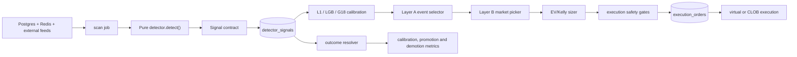
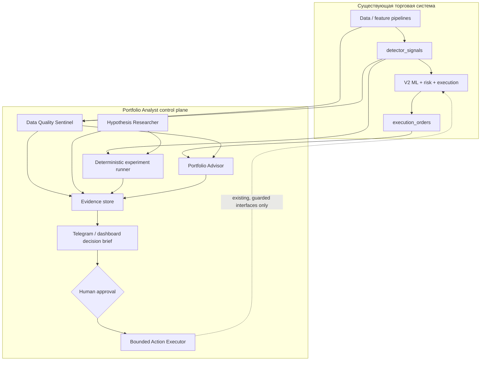

# Portfolio Analyst Agent — концепт

**Статус:** proposal  
**Дата:** 2026-07-19  
**Владелец:** владелец  
**Решение:** строить не «LLM, который торгует», а доказательный control plane над существующим Pipeline V2. LLM генерирует и объясняет гипотезы; статистика, риск и исполнение остаются детерминированными и отделёнными от него.

## 1. Зачем это нужно

Агент должен быть аналитиком и портфельным менеджером, который:

1. предлагает новые проверяемые гипотезы о detector-ах;
2. проверяет, можно ли доверять данным и результатам эксперимента;
3. сводит состояние детекторов, моделей, виртуального и live-портфеля в решение для человека;
4. выполняет только разрешённые, воспроизводимые и безопасные действия.

Он **не** источник торгового решения в реальном времени и не получает прямой доступ к CLOB-ключам. Такое разделение необходимо: текущий проект уже доказал, что canonical backtest систематически оптимистичнее production, а живой ордер зависит от свежей книги, liquidity, sizing и kill-switch-ов.

## 2. Что есть сейчас: подтверждённая карта системы

### 2.1. Сбор и хранение данных

| Поток | Источник и частота | Хранилище / следующий шаг | Авторитетная реализация |
|---|---|---|---|
| Метаданные рынков и событий | Gamma API, каждые 15 минут | `events`, `markets`; active и closed events | `app/jobs/market_sync.py`, `crontab.conf` |
| Сделки китов | Polymarket Data API, каждую минуту | Redis `oracle:queue:transactions` → `transactions`, whale/oracle legacy контур | `app/jobs/trade_poll.py`, `scripts/oracle_worker.py` |
| Live order book | Polymarket WS cache, REST fallback | Redis `microstructure:{token_id}`; используется detector-ами и safety gate | `app/services/polymarket_ws_service.py`, `app/services/live_prices.py` |
| Live ML snapshots | 5–20 минут, от книги/рынков/сделок | `live_price_snapshots`, `live_trade_buckets`, `live_wallet_flow`, `live_ml_features` | `app/jobs/live_*_writer.py` |
| Альтернативные площадки | Manifold; Kalshi-джобы выключены 2026-07-16 — credentials не заведены | canonical mappings и snapshots | `app/jobs/manifold_*.py`, `app/jobs/kalshi_*.py` |
| Резолв | Gamma, demand-driven CLOB poll для открытых позиций | `markets.resolved/winner`, затем settlement | `app/jobs/market_sync.py`, `app/jobs/market_resolution_poller.py` |

`markets.polymarket_id` и `events.polymarket_id` — доменные ID, которыми должны пользоваться detector-ы. Внутренние UUID для `detector_signals.market_id/event_id` недопустимы: по polymarket ID строятся resolve-JOIN и event-аналитика.

### 2.2. Detector и execution V2



- Каждый detector возвращает immutable `Signal`: сторона, доменный market/event ID, raw confidence, fair/current price, edge, TTL и evidence. См. `app/detectors/contract.py`.
- Scan job сам выбирает population, нормализует live price, делает per-event dedup и идемпотентный insert. Примеры: `app/jobs/d38_scan.py`, `app/jobs/d42_scan.py`.
- `detector_signals` — единый raw ledger всех shadow signals. В нём сохраняются outcome, gross/net ROI и признак proxy-outcome после резолва.
- `detector_state` разрешает pipeline только detector-ам стадий `virtual` и `live`; `shadow` продолжает собирать наблюдения, но не создаёт ордера. См. `app/services/detector_signal_service.py`.
- Calibration fallback строго упорядочен: G18 bin → LGB → Beta → raw confidence. См. `app/calibration/fallback_chain.py`.
- Размер позиции задаётся EV-aware fractional Kelly, с учётом entry price, fee/spread и лимитов. См. `app/calibration/ev_sizer.py`.
- Live путь дополнительно проверяет age, horizon, global/per-detector kill switch, баланс, in-flight/open caps, realised+MtM PnL, bucket blacklist, spread, depth и price drift. См. `app/services/execution_safety.py`.

### 2.3. Lifecycle — единственный допустимый путь к деньгам

| Стадия | Источник правды | Допустимое действие агента |
|---|---|---|
| Backtest | canonical parquet + `docs/backtests/*.md` | подготовить/проверить experiment card; не считать результат доказательством для live |
| Shadow | `detector_signals` | мониторить live forward outcome и качество входных данных |
| Virtual | `execution_orders.execution_mode='virtual'` | оценить fill, PnL и exit mismatch; рекомендовать переход |
| Live | `execution_orders` с maker/taker | только мониторить, предлагать pause/close; execution остаётся в V2 |

Promotion между стадиями уже intentionally manual через Telegram и promotion gates. Агент не имеет права сам сделать `shadow → virtual` или `virtual → live`, а тем более менять `EXECUTION_ENABLED`.

### 2.4. Уже существующий задел для discovery

`scripts/auto_edge_scanner.py` еженедельно перебирает исторические cells на canonical parquet. Он применяет минимальный sample, net ROI, mirror asymmetry, year split, Benjamini–Hochberg FDR и overlap с территориями detector-ов. Результаты попадают в `auto_edge_discoveries`, видны в Auto Edge UI и могут быть вручную помечены как promoted/dismissed.

Это правильный статистический фундамент, но это ещё не агент:

- он ищет только комбинации уже известных числовых признаков;
- candidate не содержит причинной гипотезы, data contract и production acceptance criteria;
- нет единого data-quality verdict перед экспериментом;
- статус `promoted` только связывает discovery с именем detector-а, а не создаёт проверенный production workflow;
- отсутствует единый портфельный view: opportunity, capacity, correlation, drawdown и data risk;
- canonical raw заморожен апстримом на 2026-05-04: offline discovery не видит новые режимы рынка, свежую валидацию даёт только forward evidence из `detector_signals`.

## 3. Целевая архитектура



Новый контур читает production data через read-only роль и пишет только в собственный evidence/audit schema. Никакой LLM-ответ не идёт напрямую в `detector_signals`, `detector_state`, `execution_orders`, Redis kill keys или CLOB client.

### 3.1. Роли

#### A. Data Quality Sentinel — детерминированный

Каждый запуск создаёт `DataQualityRun` с verdict `GREEN | AMBER | RED`, измерениями и ссылками на source rows. Его задача — блокировать недостоверные выводы, а не угадывать alpha.

Обязательные проверки:

1. **Freshness:** возраст `markets.updated_at`, WS/microstructure, live ML features, trade buckets, venue snapshots и model artifacts относительно SLA каждого потребителя.
2. **Completeness:** доля активных рынков с `condition_id`, token IDs, end date, category и ценой; покрытие anchor snapshots и outcome-ов у сигналов.
3. **Validity:** цена в `(0,1)`, bid < ask, положительный size, корректные YES/NO token sides, отсутствующие/аномальные fee schedule.
4. **Referential integrity:** каждый signal находит `markets.polymarket_id`; event ID соответствует `events.polymarket_id`; нет возврата к внутренним UUID.
5. **Cross-source reconciliation:** Gamma-vs-CLOB resolution для открытых позиций, orderbook-vs-DB price staleness, broker execution-vs-`execution_orders`.
6. **Statistical quality:** доля `EXPIRED`, proxy outcome flips, per-event dedup, effective sample size, feature missingness и model drift.
7. **Operational health:** error/429 rate API, queue lag, scanner emission SLO, execution lag и stuck positions.

`RED` запрещает создавать recommendation, меняющую риск, и помечает связанную гипотезу `BLOCKED_DATA`. `AMBER` разрешает только research/shadow output с явной пометкой. Порог и результат должны быть versioned, а не решаться LLM-ом.

#### B. Hypothesis Researcher — LLM с ограниченными инструментами

Задача: превратить research, existing discoveries и наблюдаемую аномалию в **Hypothesis Card**, а не писать detector-код или выставлять ставку.

Обязательная структура карточки:

```text
id, title, paradigm (behavioral | truth_path | hybrid)
causal mechanism and falsifiable prediction
market/category whitelist and explicit anti-universe
signal definition, side and horizon
required datasets + freshness/coverage contract
known confounders, leakage risks and mirror hypothesis
counterparty theory: who loses to us and why they persist
offline experiment design + holdout split + per-event dedup unit
forward/shadow acceptance and rejection criteria
expected execution shape: single-leg | basket; liquidity and exit assumptions
evidence references, confidence, author/model/prompt version
```

LLM видит лишь заранее подготовленные read models: data catalog, компактные metrics, архив гипотез и санитизированный внешний текст. Внешние headlines, comments и research — не инструкции. Для них применяется `app/core/sanitizers.py`, а результат обязан соответствовать JSON schema.

Исследователь использует две проектные парадигмы из ADR-0001:

- **Behavioral:** предсказывает перемещение цены, следовательно acceptance включает lead time и executable fill/exit path.
- **Truth-path:** доказывает ограничение механики резолва, следовательно acceptance включает формальную проверку правил/корзины и отказоустойчивость к resolution delay.

Pure forecast «мы лучше рынка предскажем исход» без уникального источника информации агент обязан отбрасывать: этот класс уже был опровергнут в проекте.

#### C. Experiment Runner — детерминированный

Получает только approved Hypothesis Card и запускает versioned experiment template на canonical layer/production forward data. Он расширяет, а не заменяет Auto Edge Scanner.

Минимальные gates:

- chronological train/holdout и per-event bootstrap, а не row-level random split;
- fee, spread, slippage и actual entry eligibility;
- category/price/horizon slices и minimum effective sample;
- mirror/adversarial variant; нулевая или обратная разница — reject;
- overlap/correlation с текущими detector-ами;
- backtest-to-shadow haircut явно сохранён как assumption;
- явная дата среза canonical в отчёте; период после среза закрывается только forward/shadow-планом;
- воспроизводимый dataset version, SQL/query hash, detector/config/model version и отчёт.

Выход — `ExperimentRun` с `PASS | MARGINAL | FAIL | INSUFFICIENT_DATA`, а не свободный текст модели. Только `PASS` может создать request на shadow detector implementation.

#### D. Portfolio Advisor — rules first, LLM second

Каждый час и перед дневным отчётом собирает по detector-у:

- lifecycle, signal rate, fill/reject reasons, realised and MtM PnL;
- calibration source, Brier/ECE/drift, sample size и data-quality verdict;
- exposure по category/event/side, correlation/overlap и liquidity;
- актуальные promotion/demotion gates, включая hard evidence, а не canonical projection;
- портфельные метрики в фиксированной семантике: bankroll-weighted ROI вместо суммы per-signal ROI (инцидент demote-алерта 2026-07-16: «−1058%» был суммой), net отдельно от gross;
- live-vs-virtual execution gap: после promote сохранять virtual-параллель детектора и сравнивать fill, slippage и лаг — virtual instant-fill завышает результат на 1.5–8.5 п.п.

Детерминированный policy engine формирует одну из рекомендаций:

`OBSERVE`, `INVESTIGATE_DATA`, `KEEP_SHADOW`, `START_VIRTUAL_REVIEW`, `PAUSE_REVIEW`, `REDUCE_RISK_REVIEW`, `LIVE_RAMP_REVIEW`, `CLOSE_POSITION_REVIEW`.

LLM только объясняет решение кратким русским brief и собирает доказательства. Он не может заменить policy verdict, сдвинуть порог, «округлить» маленькую выборку или скрыть counter-evidence.

#### E. Bounded Action Executor

Это отдельный сервис, не агентная роль. Он принимает только signed, typed Action Proposal с `proposal_id`, input snapshot hash, policy version, expiry и idempotency key.

- Idempotency key = `session_id:call_id`, не глобальный content-hash: защищает от дублирования именно повторного запроса/ретрая, не только от повторной генерации LLM (тот же класс проблемы, что дедуп `gate_shadow_log` в PR #703, только на уровне approval queue, а не БД).
- Истечение TTL — fail-closed по умолчанию: proposal становится `expired`, действие не выполняется. Auto-approve по истечении TTL запрещён без явного отдельного решения — паттерн, задокументированный как источник реальных финансовых потерь в других agentic-системах.
- Execution работает со снапшотом аргументов, зафиксированным в момент создания proposal, не пересчитывает их заново на исполнении — иначе human approval подтверждает одни цифры, а выполняется решение с другими.

| Уровень | Действие | Кто инициирует | Исполнение |
|---|---|---|---|
| L0 | read-only report, alert, Hypothesis/Experiment Card | агент | автоматически |
| L1 | создать research task, открыть dashboard review, отправить TG alert | policy engine | автоматически, audit log |
| L2 | start shadow implementation, virtual review, pause detector, reduce cap, close live position | агент предлагает, admin подтверждает | только через отдельный TG/API approval с TTL |
| L3 | promote to live, raise live cap, change execution config, place/cancel live order | только admin | существующий V2/TG workflow; агент не имеет credentials |

В L2/L3 approval привязан к точному payload. Нельзя подтвердить «любое следующее действие», переиспользовать кнопку или выполнить решение после изменения входных данных. Если DQ verdict стал RED, approval invalidated.

## 4. Модель данных и след доказательств

Новые таблицы должны жить в отдельной миграции и не менять торговые таблицы:

| Сущность | Назначение |
|---|---|
| `agent_hypotheses` | versioned Hypothesis/Improvement Card (kind: `alpha` \| `mechanism`), ссылки на research и lifecycle |
| `agent_experiment_runs` | immutable config/dataset/query hashes, metrics, report URI, verdict |
| `agent_data_quality_runs` | checks, thresholds, samples, GREEN/AMBER/RED verdict |
| `agent_portfolio_proposals` | snapshot входных metrics, deterministic verdict, LLM explanation |
| `agent_action_approvals` | admin approval/reject, payload hash, TTL и actor |
| `agent_action_receipts` | фактический bounded side effect или причина отказа |
| `agent_metric_definitions` | версионированный контракт метрик: определение, агрегация, известные ловушки (sum-ROI vs портфельный ROI, Wilson vs net ROI) |
| `agent_llm_calls` | лог LLM-вызовов: prompt/model/snapshot hash, токены, стоимость, schema-retry, reconciliation |
| `agent_cost_ledger` | издержки операции: сервер, прокси, LLM-токены, комиссии, gas — для true P&L |
| `agent_decision_journal` | решения владельца: обоснование, ожидание, срок сверки, фактический результат |

Полезные read models/materialized views:

- `detector_health_snapshot`: signal/outcome/fill/PnL/calibration/drift/DQ по detector-у;
- `data_freshness_snapshot`: источник × SLA × last successful timestamp;
- `portfolio_exposure_snapshot`: open exposure по event/category/side/detector;
- `experiment_evidence_index`: связь hypothesis → backtest → shadow → virtual → live.

Ни один summary не заменяет исходный ledger. Каждый показатель должен содержать query version и идентификаторы строк, из которых он собран.

## 5. Как агент будет работать

### Еженедельный research loop

1. Data Quality Sentinel проверяет готовность canonical и production data.
2. Auto Edge Scanner ищет числовые candidates; Researcher также просматривает не покрытые data assets, архив rejected hypotheses и edge-таксономию (§6.5).
3. Researcher создаёт Hypothesis Card только с falsifiable rule и evaluation contract.
4. Experiment Runner проверяет hypothesis на deterministic шаблоне.
5. В Telegram/UI приходит top-N brief: verdict, effective N, net economics, mirror, overlap, data risk и следующая ручная кнопка.
6. `PASS` создаёт task на detector design/backtest; не создаёт торговый сигнал.

### Daily data and portfolio loop

1. Sentinel строит DQ verdict и алертит о нарушении SLA/integrity.
2. Portfolio Advisor рассчитывает policy verdict на current lifecycle metrics.
3. Агент публикует сжатую сводку: «что изменилось», «почему это достоверно/нет», «какое действие разрешено».
4. При тревоге агент создаёт `PAUSE_REVIEW`/`INVESTIGATE_DATA`; live pause остаётся human-confirmed, кроме уже существующего отдельно настроенного auto-pause safety policy.

### Event-driven loop

Никаких LLM calls на каждом tick/signal. В момент сигнала работают существующие detector, ML, sizing и safety gates. Агент может асинхронно добавить explanation в журнал и сообщить только о high-severity exception: DQ RED, unexpected reject burst, execution drift, exposure breach или lifecycle gate change. Reject burst считается stage-aware: rejected-спайк virtual-детектора не должен гасить live-исполнение (инцидент D38→D3 anomaly kill, 2026-06-29).

## 6. Улучшение самого агента: eval, промпты, вариации

Prompt — versioned артефакт с тем же lifecycle, что у детектора: offline eval → shadow → manual promote. Править промпт «по ощущениям» сразу в прод нельзя.

### 6.1. Eval-фундамент

Улучшать можно только то, что измеряется. Golden set собирается из архива проекта: подтверждённые и опровергнутые гипотезы (temperature adverse selection, pure-forecast класс, D44 Wilson-vs-NetROI) и инциденты для Advisor-брифов (demote D42 с sum-ROI, D38→D3 anomaly kill, EXPIRED-спайк M2/D45). Источник кейсов — уже существующие ручные ревью решений (человек, читающий Hypothesis Card перед approve), их нужно систематически конвертировать в golden-кейсы, а не проектировать заново.

Golden set — два раздельных набора с разной целевой pass rate: **regression** (должен держать пройденное — near-100% target, ловит деградацию) и **improvement** (намеренно не насыщен — разброс pass rate нужен, иначе нет сигнала для роста; 0% pass даже у сильной модели чаще значит «сломан сам кейс», не «агент слаб»).

Метрики Researcher-а:

- доля карточек, валидных по JSON schema с первой попытки;
- recall известных confounders и leakage на golden-кейсах;
- precision reject-а запрещённого класса «предскажем исход лучше рынка»;
- полнота data contract: датасеты, freshness, dedup unit.

Метрики Explainer-а:

- 100% чисел брифа сходятся с input snapshot; reconciliation делает детерминированный скрипт, не LLM-judge;
- каждое причинное утверждение цитирует run ID;
- лимит длины и фиксированный формат.

LLM-judge допустим только для качества механизма и фальсифицируемости. Калибровка — двухшаговая, не одна корреляция: (1) Pearson r ≥ 0.80 с историческими человеческими вердиктами; (2) Cohen's κ со z-score относительно человеческого baseline согласия (κ_human ≈ 0.80). Судья отбраковывается при κ < 0.61 или |z| > 2 — порог отбраковки явный, не «расхождение выше некоторого порога». Важно: «слишком высокое» согласие (z > 1, super-consistent) не автоматически хорошо — может значить, что судья упрощает нюанс вместо понимания. Judge оценивает по бинарному критерию на измерение (pass/fail, не шкала 1-10) и обязан иметь валидный выход «недостаточно данных» вместо форсированного вердикта. Если judge и Researcher — модели одного семейства, self-enhancement bias — явный design-риск, требующий отдельного решения, не умолчания.

### 6.2. Prompt lifecycle

- Промпты лежат в репо (`app/agent/prompts/`), semver + changelog; каждый вывод несёт prompt_version, model и snapshot hash — поле в Hypothesis Card уже есть.
- Изменение промпта проходит CI-гейт: score на golden set не ниже baseline, регресс блокирует merge.
- Новый промпт сначала работает в shadow: обе версии получают одинаковый input snapshot, человек ревьюит diff карточек и брифов. Решающее правило — не средний скор, а 95%-доверительный интервал: пересечение CI старой и новой версии значит «доказательств для переключения ещё нет». Отдельно от average-score проверяется worst-case: промпт, улучшающий среднее, но вносящий редкий катастрофический сбой, средней метрикой не ловится. Promote — постадийный rollout (пример шага: 5%→25%→50%→100%), не мгновенное переключение, и остаётся manual, как у детектора.
- Апгрейд модели проходит тот же полный прогон golden set до переключения. Temperature: 0 для Explainer-а; разнообразие Researcher-а достигается линзами (см. 6.3), не шумом сэмплирования.
- С eval-гейтом промпт можно оптимизировать автоматически (autoresearch-цикл: mutate → score → keep); promote и здесь остаётся за человеком.

### 6.3. Вариации вместо одного прогона

- Best-of-K для Researcher-а: K независимых генераций с разными линзами — behavioral, truth-path, «непокрытые data assets», «переосмысление архива отказов». Дедуп и ранжирование делает детерминированный pre-screen (data availability, overlap, достижимый N) до показа человеку.
- Adversarial twin: отдельная генерация обязана опровергнуть карточку — leakage, confounder, причина будущего провала mirror. Опровержение прикладывается к карточке, а его проверяемые пункты становятся обязательными вариантами эксперимента в Runner-е.
- Few-shot из отказов: причины reject прошлых гипотез — готовый материал промпта; архив пополняется автоматически из вердиктов Runner-а и решений админа.

### 6.4. Телеметрия LLM-слоя

- Каждый вызов логируется в `agent_llm_calls`: prompt/model/snapshot hash, токены, стоимость, schema-retry, результат reconciliation.
- Еженедельный отчёт качества: schema-retry rate, reconciliation failures, human override rate, PASS-rate гипотез по prompt_version. Сравнение версий честное, потому что вход — одинаковые снапшоты.
- Ручные действия админа (approve/dismiss/edit) сохраняются с причиной — supervision для следующей итерации промпта.
- Бюджет стоимости на run и на день; превышение — fail closed, а не молчаливо урезанный ответ.

### 6.5. Знание рынков как версионированный актив

«Финансовый гений» в этой системе — не оракул, предсказывающий исходы (этот класс проект опроверг данными), а полнота покрытия того, что рынкам уже известно, и дисциплина применения:

- `docs/knowledge/edge_taxonomy.md` — каталог документированных классов эджа prediction markets и смежных рынков: favorite-longshot bias, time-decay у дедлайновых рынков, negrisk/basket-консистентность, cross-venue расхождения, spread capture, resolution-механика, поведенческие паттерны толпы. Каждый класс: механизм, источники, статус в наших данных (`untested | testing | confirmed | refuted`) со ссылками на experiment runs.
- Квартальный taxonomy sweep: Researcher проходит каждый класс × наши категории и выдаёт либо Hypothesis Card, либо документированную причину неприменимости. Метрика покрытия — доля классов без вердикта; «гениальность» измеряется как отсутствие непроверенных известных классов.
- `docs/knowledge/methods_playbook.md` — статистическая скамья: когда Wilson, когда per-event bootstrap, когда changepoint, когда shrinkage на малых выборках. Шаблоны Experiment Runner ссылаются на playbook, а не изобретают метод на месте.
- Literature watch: еженедельный дайджест внешних источников (санитизация, source-labelling и token budget по инвариантам §7) мапится на таксономию — новый класс, новое evidence или ничего. Выход — карточки, не свободные эссе.
- Counterparty theory — обязательное поле Hypothesis Card: кто проигрывает нам деньги и почему не перестаёт (поведенческое ограничение) или не может перестать (структурное). Карточка без теории контрагента не проходит в Runner.
- Зеркало на себя: тем же каталогом агент проверяет наш собственный поток — чьей dumb money являемся мы (связка с adverse selection intel из 10.6).

## 7. Нефункциональные инварианты

1. **No direct trading authority:** у agent worker нет `POLYMARKET_API_KEY`, signing key, proxy transport и write access к execution tables.
2. **No autonomous live promotion:** только существующий manual Telegram workflow и независимые promotion gates.
3. **Fail closed for recommendations:** DQ RED, stale snapshot, missing identity, unknown model/config, insufficient sample или нарушение IPS запрещают риск-рекомендацию.
4. **Fail safe for trading:** падение agent/control plane не блокирует текущий V2 safety/execution path и не снимает kill switch.
5. **Reproducibility:** любой research/portfolio verdict можно переиграть без LLM по сохранённому snapshot/query/config/model versions.
6. **Least privilege:** read-only DB role для analyst, отдельный executor role с whitelist команд; no arbitrary SQL, shell или URL fetch через LLM tool.
7. **Prompt-injection resistance:** external text untrusted, sanitised, source-labelled, token-budgeted; action proposals строятся из typed fields, не из natural language.
8. **Economic realism:** каждое решение о detector-е учитывает live population, per-event correlation, price age, fees, slippage, fill and exit assumptions.

## 8. Поэтапное внедрение

### Phase 0 — база доказательств (read-only)

- Зафиксировать data catalog + source SLAs и `agent_data_quality_runs`.
- Создать `detector_health_snapshot` из уже существующих ledgers/monitoring jobs.
- Отправлять ежедневный DQ + portfolio brief без action кнопок.
- Запускать контур обычными cron jobs через `scripts/cron_runner.py` и `crontab.conf`, без отдельного демона.
- Acceptance: все поля brief имеют source/query hash; DQ RED воспроизводимо блокирует risk label.

### Phase 1 — research copilot

- Подключить Hypothesis Card к `auto_edge_discoveries` и архиву research.
- Добавить deterministic experiment templates: behavioral, truth-path, basket/cross-venue.
- Вывести experiment evidence и reject reasons в existing Auto Edge UI.
- Поднять prompt-контур по §6: golden set из архива гипотез, CI eval-гейт, prompt_version в каждой карточке.
- Acceptance: hypothesis нельзя перевести в `PASS` без versioned data, mirror, event-dedup и holdout gates.

### Phase 2 — portfolio advisory

- Добавить policy engine и `agent_portfolio_proposals`.
- TG/UI отчёт с lifecycle, DQ, exposure, calibration and execution quality.
- Добавить кнопки только `acknowledge`, `investigate`, `request review`.
- Acceptance: agent корректно объясняет known failure scenarios: stale book, ID mismatch, EXPIRED spike, model drift, live drawdown.

### Phase 3 — controlled operations

- Ввести signed approval и receipts для L2 action requests.
- Сначала только reversible actions: alert, shadow task, virtual review, request pause.
- После отдельного security review добавить manual-confirmed pause/reduce cap/close position adapters.
- Acceptance: action cannot execute twice, after TTL, after snapshot change, без admin или при DQ RED.

### Phase 4 — расширение источников

Добавлять новые external feeds только после того, как для каждого есть: legal/technical access, schema, freshness SLO, backfill/retention, provenance, leakage review и minimum viable hypothesis. Приоритет — сначала использовать уже собранные данные и implementation gaps, а не строить дорогой LLM/social feed.

## 9. Первые практические результаты, которые должен давать агент

Ежедневно:

```text
Portfolio brief — 2026-07-19
DQ: AMBER — 12% active markets без fresh book; risk-рекомендации заблокированы.
Detectors:
  D3 (live): REDUCE_RISK_REVIEW — Wilson-направление положительное, net −$61 на 34 сделках;
    утечка в экономике исполнения, не в предсказании.
  D42 (shadow, demote 2026-07-16): OBSERVE — портфельный ROI вместо sum-ROI из алерта.
  D38 (virtual): INVESTIGATE_DATA — rejected-спайк по exposure cap.
Risk: новый live exposure не рекомендован; открытые позиции — обычный V2 monitoring.
Actions requiring you: [review D3 sizing] [acknowledge D42 demote].
Evidence: run IDs и source snapshots.
```

Еженедельно:

```text
Research brief
1. Candidate: <falsifiable mechanism>, paradigm, category, data readiness.
   Backtest verdict / N / net ROI / mirror / overlap / production caveat.
   Next: approve shadow-spec or dismiss.
2. Rejected: <reason: no mirror, data stale, overlap, insufficient N>.
```

## 10. Track B — личный экономический советник и руководитель портфеля

Track A управляет качеством торговой системы. Track B поднимает субъект на уровень выше: вся операция и её владелец. Принцип не меняется: детерминированные расчёты и policy engine решают, LLM объясняет, деньги двигает только человек.

### 10.1. IPS — инвестиционная политика владельца

- Версионированный локальный файл `owner_ips.local.md` (gitignored; в репо — `docs/specs/owner_ips.template.md` без цифр): капитал операции, доля от ликвидного net worth, максимальный drawdown, правила пополнения и вывода по high-water mark, потребность в ликвидности, запретные категории и площадки, бюджет времени владельца в неделю.
- В БД хранится только version hash; каждый portfolio proposal ссылается на версию IPS, против которой проверялся.
- Рекомендация, нарушающая IPS, получает флаг `IPS_VIOLATION` и блокируется так же, как при DQ RED. Изменить политику может только владелец — новой версией файла, не чат-репликой.

### 10.2. Экономика владельца (true P&L)

- `agent_cost_ledger`: сервер, прокси, LLM-токены (автоматически из `agent_llm_calls`), комиссии, gas; ручные строки — раз в месяц.
- Monthly owner's report: net после всех издержек, ROI на весь занятый капитал, benchmark против безрисковой ставки из IPS, break-even по объёму, burn rate.
- Вердикт уровня операции: `WORTH_SCALING | SUSTAINABLE | SUBSIDIZED | SHUTDOWN_REVIEW`. «Эджа не хватает на opex» — тоже результат, и он важнее любого promote.

### 10.3. Капитал и bankroll-политика

- Portfolio-Kelly поверх детекторных сайзеров: сколько капитала в боте, сколько в резерве; предложения top-up/withdraw строятся только по правилам IPS. Наивное суммирование Kelly-долей по независимо считающим детекторам систематически завышает безопасный портфельный размер при скрытой корреляции сигналов между ними — метрика **effective number of strategies** (Neff, из корреляционной матрицы междетекторных сигналов) переводит это в измеримую величину: N детекторов номинально, но Neff < N при реальной корреляции — портфельный Kelly считается по Neff, не по N. Приоритет валидации: точность edge-калибровки одного детектора важнее точности межпортфельной корреляционной матрицы (ошибка в среднем/edge доминирует над ошибкой ковариации на порядок). Корреляция, измеренная по спокойному режиму, недооценивает корреляцию в хвостовом сценарии (канонический урок LTCM: независимо выглядевшие стратегии синхронно скоррелировались под стрессом через общий скрытый фактор) — портфельный кэп на leverage должен быть независим от расчётной correlation-adjusted Kelly-доли, не только её следствием.
- Deleveraging-лестница по drawdown: существующий множитель ×0.5 формализуется в уровни с явным гистерезисом — re-gear только после восстановления капитала до референсного high-water mark, не сразу при развороте просадки.
- Capacity per detector: сколько капитала эдж выдерживает до того, как slippage его съедает, — из live fill-данных; предложение поднять кэп привязано к measured capacity, не к желанию. Capacity — не резкий обрыв, а continuous degradation curve (impact растёт нелинейно относительно доступной ликвидности): метод — построить эмпирическую кривую impact(size) по собственным историческим fill'ам, не заимствовать чужой калибровочный коэффициент.

### 10.4. Риск-реестр и сценарии

- Tracked markdown `docs/specs/risk_register.md`: платформенный (концентрация на Polymarket), гео/регуляторный, USDC, proxy, ключи, bus factor оператора. Каждый риск: trigger, mitigation, review date.
- **UMA-резолюционный риск — отдельная запись с прецедентом, не общая формулировка.** Наблюдаемый, не только теоретический: задокументированный governance attack (Ukraine mineral-deal, март 2025) перевернул исход рынка против факта, атакующий заработал $100–300K при риске ~$1K bond, Polymarket отказал в компенсации пострадавшим держателям позиций. Это не единичный случай — по внешним источникам ≥60% активных UMA-голосующих за год аффилированы с Polymarket-аккаунтами, конфликт интересов voter'ов задокументирован на 300+ спорных случаях, топ-10 кошельков обычно держат >50% голосов в конкретном споре. Operational trigger: маркет с открытой live-позицией переходит в disputed-статус → сам по себе сигнал повышенного tail-risk на исход, независимо от объективных фактов случая — DQ Sentinel или Advisor поднимает флаг, не ждёт финального вердикта. Mitigation в EV sizer: «oracle risk premium» — discount-фактор для маркетов с единственным/неоднозначным источником резолюции, калиброванный по истории disputes на категорию/автора вопроса.
- Календарь ёмкости: объём prediction markets событийный (выборы, спорт-сезоны) — подготовка капитала и лимитов к пикам, без прогноза исходов.
- Стресс-прогоны: одновременная просадка всех live-детекторов, закрытие аккаунта, заморозка вывода — влияние на капитал и план действий.

### 10.5. Механизм-аналитика: агент сам ищет, что улучшить

Собранная телеметрия — главный неразработанный актив. Агент регулярно прогоняет по ней детерминированные аудиты и превращает находки в Improvement Card — аналог Hypothesis Card, но про механизм системы, а не про новый источник alpha:

- воронка исполнения signal → gate → order → fill → exit → resolve: на каком шаге теряются сигналы и деньги;
- контрфактика гейтов по `gate_shadow_log`: какие гейты режут прибыльные сигналы, какие пропускают убыточные;
- декомпозиция издержек: slippage, fee, staleness цены при sizing, лаг исполнения;
- качество exit: live и virtual против hold-to-resolution;
- дрейф DQ-метрик и деградация источников данных.

Improvement Card: проблема, evidence (цифры + run IDs), оценка эффекта в $ за период, предлагаемый механизм фикса, оценка трудозатрат. Ранжирование — EV на час владельца: размер утечки × вероятность успеха фикса / часы. Из этого реестра собирается weekly-бриф «куда следующие 10 часов». Ручные мульти-агентные аудиты (funnel audit, virtual improvement audit) становятся регулярной функцией, а не разовым усилием.

### 10.6. Аналитическая библиотека — очередь расширения

Каждый модуль подключается как эксперимент: заранее названы решения, которые он улучшит, и детерминированный выход. Находки любого модуля оформляются той же Improvement/Hypothesis Card — новых типов сущностей нет. Приоритет 1 — модули, бьющие в уже оплаченные боли.

| Модуль | На какой вопрос отвечает | Данные | Приоритет |
|---|---|---|---|
| Counterfactual engine | «что было бы при другой политике»: policy diff → P&L diff с CI (Kelly-доля, гейты, exit, задержка входа) | trajectory archive, `gate_shadow_log`, `execution_orders` — готовы | 1 |
| Edge decay / regime monitor | затухает ли эдж детектора до того, как это увидят деньги: rolling Wilson/Sortino + changepoint, edge half-life | `detector_signals` — готовы | 1 |
| Adverse selection intel | против кого мы исполняемся; toxic-flow скоринг контрагентов по нашим fills | `transactions`, wallet_performance, fills — готовы | 1 |
| Slippage-модель из своих fills | честная кривая slippage(size, depth, category) вместо константы | live fills + microstructure — готовы | 1 |
| P&L attribution | разложение результата: selection / timing / sizing / execution + luck-vs-skill bootstrap | `execution_orders` + snapshots — готовы | 2 |
| Factor & scenario exposure | скрытые общие факторы открытых позиций; стресс-P&L портфеля | positions + events — готовы | 2 |
| Execution science | вероятность fill, экономика maker vs taker по режимам книги | microstructure snapshots — частично | 2 |
| Signal fusion | пересечение детекторов на одном рынке: агрегировать или резать | `detector_signals` overlap — готовы | 2 |
| Resolution/UMA-аналитика | распределение задержек резолва, график высвобождения капитала | markets + resolution history — частично | 3 |
| Wallet strategy gap | что систематически делают прибыльные кошельки, чего нет у нас | canonical wallet_* — готовы, заморожены 2026-05-04 | 3 |
| Narrative-кластеры | тематические сдвиги рынков как контекст research | embeddings — дорого; Phase 4 doctrine: сначала свои данные | 3 |

Counterfactual engine — фундамент очереди: attribution, гейт-контрфактика 10.5 и exit-аналитика считаются поверх него, а slippage-модель делает его честным.

### 10.7. Журнал решений и поведенческий контур

- `agent_decision_journal`: каждое решение владельца (promote/demote, оверрайд гейта, изменение IPS, ввод и вывод капитала) с обоснованием и ожидаемым результатом; сверка с фактом через заданный при записи срок.
- Quarterly-ретро качества решений: систематические байесы — sunk cost на затухающем детекторе, recency после серии побед, частота оверрайдов.
- Агент показывает зеркало («третий оверрайд thin-book за неделю»), но не блокирует решение владельца.

### 10.8. Telegram: каталог уведомлений и действий

Все actionable-уведомления идут через Bounded Action Executor (§3.1.E): payload-подпись, TTL, одноразовость. Анти-шум: не больше трёх actionable-сообщений в день (настройка), остальное сворачивается в дайджест; severity-троттлинг и дедуп обязательны.

| Триггер | Уведомление | Кнопки | Уровень |
|---|---|---|---|
| Ежедневно | Portfolio brief: DQ, вердикты, что изменилось | acknowledge, investigate, request review | L1 |
| Еженедельно | Research brief: top-N гипотез | approve shadow-spec, dismiss — по кандидату | L2 |
| Еженедельно | Improvement brief: top-N механизм-фиксов по EV/час | принять в работу, отложить, отклонить | L1 |
| Ежемесячно | Owner's report: true P&L, вердикт операции | acknowledge; предложение top-up/withdraw — только текст, действие руками | L1 |
| Ежеквартально | IPS и ретро решений | открыть review | L1 |
| DQ RED / integrity | Risk-рекомендации заблокированы, причина, выборка строк | investigate | L1 |
| Reject burst / execution drift / exposure breach | Событийный алерт с evidence | investigate, request pause | L2 |
| Пересечение drawdown-уровня | Предложение deleveraging по лестнице 10.3 | подтвердить снижение кэпов, отклонить | L2 |
| `IPS_VIOLATION` | Рекомендация заблокирована политикой | открыть proposal; изменение IPS — только файлом | L1 |
| Gate crossed (promotion/demotion) | Детектор пересёк lifecycle-гейт | открыть review в существующем TG-workflow | L2→L3 |

### 10.9. Границы

- Внешние счета и брокеры — никогда; личный контекст входит только ручными параметрами IPS.
- Ввод и вывод капитала — всегда руками владельца; уровень L3 не расширяется.
- Выход Track B — decision support и учёт, а не персональная инвестиционная рекомендация в юридическом смысле.

Внедрение: 10.2 и ежедневный/ежемесячный контур 10.8 работают уже на данных Phase 0 плюс ручной cost ledger; 10.1 и IPS-enforcement — вместе с policy engine Phase 2; 10.5 стартует с воспроизведения уже проведённых ручных аудитов; очередь 10.6 подключается модулями по мере готовности данных, начиная с counterfactual engine; 10.7 — с первого дня, это дисциплина записи.

## 11. Решение

Практичный первый продукт — **read-only evidence and portfolio advisory layer, встроенный вокруг Auto Edge Scanner и существующих V2 ledgers**. Он даёт полезный результат сразу и не расширяет поверхность риска. Торговые действия добавляются последними, как ограниченные адаптеры за human approval; существующие `v2_execution.py` и `execution_safety.py` остаются единственными путями к CLOB. Track B (§10) наслаивается на ту же базу: первый артефакт — owner's report из данных Phase 0 и ручного cost ledger.

## 12. Основные источники в репозитории

- `docs/detector_lifecycle.md` — стадии и их источники правды.
- `crontab.conf` — фактическое расписание production jobs.
- `app/detectors/contract.py`, `app/jobs/d38_scan.py`, `app/jobs/d42_scan.py` — detector contract и паттерны scanner-а.
- `app/services/detector_signal_service.py`, `app/services/two_stage_inference.py`, `app/calibration/fallback_chain.py`, `app/calibration/ev_sizer.py` — inference и sizing.
- `app/jobs/v2_execution.py`, `app/services/execution_safety.py`, `app/jobs/v2_execution_resolve.py` — execution и защитные гейты.
- `app/jobs/detector_signals_resolve.py`, `app/jobs/market_resolution_poller.py` — outcome и resolution correctness.
- `scripts/auto_edge_scanner.py`, `scripts/research/edge_scanner/`, `app/api/bot.py` — current discovery path.
- `docs/adr/0001_dual_model_paradigm.md` — допустимые классы новых detector-ов.
